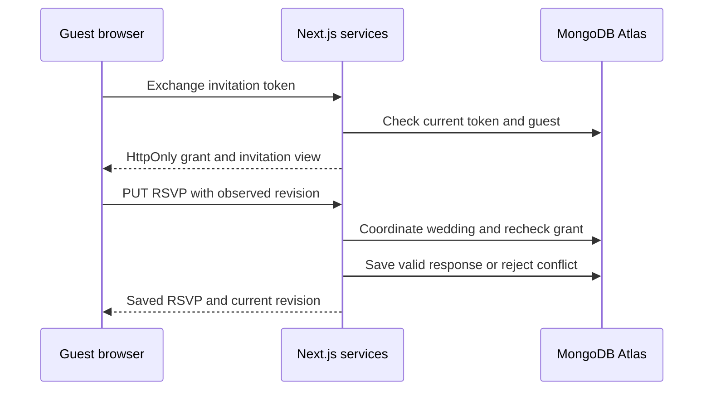

# KalyanaPura V1 — API Design

Version 1.0 | 9 October 2026 | Implementation planning baseline

## 1. Purpose and decisions

This document defines how the KalyanaPura frontend, guest pages and integration callbacks use the backend. It follows **KalyanaPura V1 — System Design Architecture** and **KalyanaPura V1 — Database Design**. The approved product rules remain authoritative. Section 24 identifies the small database additions needed to support upload retries; they are explicit rather than assumed to exist already.

KalyanaPura remains one full-stack Next.js application on Node.js. Product APIs are Next.js Route Handlers calling server-only services. MongoDB Atlas stores application data. Better Auth owns member authentication. Cloudinary stores images, Resend sends email, and Inngest invokes background functions in the same application. There is no separate Express server, microservice or guest account system.

The API has four access paths:

| Access path | Authentication | What it can expose |
|---|---|---|
| Member dashboard | Better Auth session and current wedding membership | Wedding planning data allowed to Admin or Manager |
| Personal invitation | Valid invitation-derived guest cookie | That guest’s invited events, own RSVP and wedding gallery access |
| Shared gallery | Valid shared-gallery-derived guest cookie | Gallery viewing/upload capabilities enabled by organisers |
| Public website | No login; published wedding slug | Explicit public presentation fields and selected public events |

Server Components call the same internal read services directly for initial rendering. They do not call the application’s own HTTP API merely to read data. Browser interactions use these HTTP contracts. Both paths apply identical permissions and projections.

### 1.1 Keeping V1 simple

- One account belongs to at most one wedding. Admin and Manager are the only member roles; Manager is the invitation default.
- Guests use links and QR codes without accounts. One guest record has one overall RSVP, including a total party size.
- Use REST-style JSON resources with a few explicit commands for invitations, uploads and publication.
- Refresh data after successful changes. V1 has no WebSockets, SSE, subscriptions or generic workflow engine.
- My Vendors is internal CRUD. Discovery opens Google Maps externally; there is no Google Places API.
- No payments, budgets, booking workflow, per-event RSVP, WhatsApp API, bulk photo export or platform administration API.
- Deployment and provider quotas remain a separate stage. This document does not enable paid services or promise unlimited free hosting.

## 2. URLs and application boundaries

Product endpoints use `/api/v1`. In the catalogues, **`W` means `/api/v1/weddings/{weddingId}`**. All IDs in paths are actual IDs, not display names.

| Prefix or route | Owner | Purpose |
|---|---|---|
| `/api/v1/me` | Accounts service | Current member identity, wedding membership and UI limits |
| `/api/v1/weddings` | Wedding service | Wedding creation and protected wedding resources |
| `/api/v1/member-invitations/...` | Membership service | Invitation inspection and acceptance outside a current wedding |
| `/api/v1/guest/...` | Guest services | Scoped invitation, RSVP, gallery and media access |
| `/api/v1/public/weddings/{slug}` | Website service | Published public projection |
| `/api/v1/operations/{operationId}` | Operations projection | Safe background-operation status |
| `/api/auth/*` | Better Auth | Library-owned authentication handlers |
| `/api/webhooks/resend` | Resend adapter | Verified delivery evidence |
| `/api/webhooks/cloudinary` | Cloudinary adapter | Verified upload/processing notifications |
| `/api/inngest` | Inngest SDK | Function discovery, registration and signed execution |

Browser page URLs are separate from API URLs:

| Page URL | Meaning |
|---|---|
| `/dashboard/...` | Private member navigation; section URLs can be finalised during UI design |
| `/join/{token}` | Email-bound member invitation; preserves context across login |
| `/invite/{token}` | Personal guest entry link |
| `/gallery/{token}` | Stable shared gallery link encoded in its QR code |
| `/invitation` | Clean personal-invitation view after guest access is established |
| `/gallery` | Clean guest-gallery view using the current guest cookie |
| `/w/{slug}` | Published public wedding website |

Names changing never change a chosen website slug. Unpublishing `/w/{slug}` does not affect `/invite/{token}` or `/gallery/{token}`. Configure one trusted `APP_ORIGIN` for generated links; do not use an untrusted request Host header.

## 3. Common HTTP contract

### 3.1 Content and identifiers

Requests and responses use UTF-8 JSON unless the endpoint specifies CSV or image bytes. Mutations require `Content-Type: application/json`; CSV preview uses multipart form data. Reject unknown writable fields and MongoDB operators. PATCH is an allowlisted partial update, not JSON Patch or a MongoDB update document.

| Value | API representation | Rule |
|---|---|---|
| Application resource ID | 24-character hexadecimal string | Validate and convert to ObjectId on the server |
| Better Auth user ID | String | Preserve the adapter’s canonical ID; do not assume ObjectId |
| Revision | Integer `version`, starting at 1 | Business revision; coordination writes do not change it |
| Date-only value | `YYYY-MM-DD` | Valid calendar date interpreted in `Asia/Kolkata` |
| Timestamp | RFC 3339 UTC string, e.g. `2026-12-10T12:30:00.000Z` | Event requests must contain an explicit offset; responses use UTC |
| Money | Nonnegative integer-paise decimal string | `"125050"` means ₹1,250.50; fixed currency `INR` |
| Quota/retained bytes | Integer decimal string | Exact serialization of stored Long values |
| Original file size | Integer JSON number | At most `10000000`, safely within the numeric range |
| Optional scalar/reference | JSON `null` | Clears an optional field in PATCH |
| Optional list | `[]` | Clears associations; omit the field to leave it unchanged |

Money input matches `^(0|[1-9][0-9]*)$` and must fit a signed BSON Long per record. Do not accept floating-point rupees in API amounts. The UI converts a rupee decimal string to paise exactly; totals remain exact decimal strings even if their sum is larger than a per-record Long.

### 3.2 Success envelopes

Single-resource responses:

```json
{
  "data": {
    "id": "67f100000000000000000011",
    "version": 3,
    "title": "Confirm caterer",
    "status": "in_progress"
  },
  "meta": { "requestId": "req_8f5d" }
}
```

List responses:

```json
{
  "data": [],
  "page": { "limit": 25, "hasMore": false, "nextCursor": null },
  "meta": { "requestId": "req_8f5d" }
}
```

Accepted background work:

```json
{
  "data": {
    "operationId": "67f100000000000000000090",
    "status": "queued",
    "statusUrl": "/api/v1/operations/67f100000000000000000090"
  },
  "meta": { "requestId": "req_8f5d" }
}
```

A `204` response has no body. Auth library responses, binary media and provider callbacks keep their own appropriate formats; do not wrap them in this product envelope.

### 3.3 Response headers

Send `X-Request-Id` on product responses. Use `Cache-Control: private, no-store` for member, guest, operation, upload and private-media responses. Public website JSON is also `no-store` in V1 so unpublishing and saved changes take effect on the next request. Individually public cover bytes can use provider caching; previously downloaded public content cannot be recalled.

Single editable resources return `X-Resource-Version: 3` and a numeric `version` in their data. Website, livestream and gallery-settings endpoints use the **wedding’s version**, rather than separate undocumented revisions. These are business revisions, not cache validators: related display fields, quota projections and request IDs can change without changing the edited record’s revision. V1 does not use ETags or conditional caching for these dynamic projections.

Created resources return `201` with `Location`. Accepted operations return `202` with their status `Location` and `Retry-After: 2`. Rate-limited responses include `Retry-After`. Unsupported methods return `405` with `Allow`.

### 3.4 Resource projections

Member CRUD resources return `id`, `version`, `createdAt`, `updatedAt` and the documented readable business fields for that resource. Application IDs are renamed from `_id`; internal `weddingId` is unnecessary on a resource already scoped by `W`. API `email` maps to stored `emailNormalized` on guests/vendors/invitations. Do not return normalized search fields, `schemaVersion`, write fences, token hashes/ciphertext or raw provider metadata.

Tasks also return server-owned `completedAt` and a nullable safe assignee display `{membershipId, name}`. Expenses can return nullable `{id, name}` event/vendor display references; references to a deleting event are hidden with the expense, and references to a deleting vendor display as null. Member guest reads include the complete own-record RSVP metadata but never bearer tokens. Single-resource POST/PATCH responses use the same member projection as GET, rather than an unrelated response shape.

Wedding reads include identity/presentation fields, timezone/currency, safe website/livestream settings and guest gallery toggles. Quota detail belongs to gallery settings. Photo, invitation-link, operation, public and guest projections remain the narrower explicitly defined exceptions. No endpoint serializes an entire stored MongoDB document.

## 4. Access, cookies and request protection

### 4.1 Members

Resolve identity with Better Auth on every protected request. Require verified email and a current `active` membership for wedding resources. Membership determines the wedding and role; a browser-supplied wedding ID cannot grant access. A membership marked `removing` immediately loses dashboard access even while task cleanup continues.

Better Auth uses HttpOnly, Secure cookies on HTTPS, trusted origins and SameSite protection. The architecture sets an absolute seven-day member-session lifetime, disables session cookie caching for authoritative checks and revokes existing sessions on password reset. Account deletion is disabled in V1 so it cannot bypass last-Admin protection. [R1][R2]

### 4.2 Guest access without guest accounts

`POST /api/v1/guest/access` exchanges an entry-link token for an encrypted, authenticated HttpOnly guest cookie. This lets ordinary `` requests and individual download links use same-origin media routes without putting the bearer token into every image URL. It is a derived capability, not a registered guest account or an additional database collection.

Request:

```json
{
  "source": "invitation",
  "token": "illustrative-token-not-a-real-credential"
}
```

`source` is `invitation` or `gallery`. Tokens are 32 random bytes encoded as URL-safe text. Validate the digest against the corresponding current record. The cookie contains the wedding ID, source type, guest ID when applicable, captured token version and an expiry. Encrypt it with a versioned server key. Set `Secure`, `HttpOnly`, `SameSite=Lax`, `Path=/`, no Domain, using a host-only name such as `__Host-kp-guest` in production.

Use a seven-day cookie lifetime as an implementation default. This does **not** expire the invitation or gallery link: reopening the valid entry link renews guest access. One current guest context per browser is sufficient for V1; opening a different link replaces that context. Member and guest cookies are separate. `/guest/...` uses only guest authority; member endpoints use only member authority.

Every guest request rechecks the current database record, token version and applicable view/upload toggles. Never authorise solely from the encrypted cookie. Replacing, disabling or deleting a personal invitation immediately invalidates its derived grants on subsequent requests. The shared QR grant is independent of a personal invitation.

After the exchange, replace the browser history entry with `/invitation` or `/gallery`. Token entry pages use `Referrer-Policy: no-referrer`, contain no third-party scripts and do not load third-party embeds before removing the token from the URL. Redact token-bearing paths, Cookie headers and token bodies from logs, analytics and error reports.

### 4.3 CSRF, origins and media

For product mutations, require an exact configured Origin match, JSON content type and an `X-KP-Request: 1` header. Validate this on guest access exchange as well as cookie-authenticated mutations. The CSV endpoint has the same Origin/custom-header checks. Reject cross-site requests; do not configure permissive credentialed CORS. A non-browser internal caller must use a separate narrowly authorised integration handler, not a bypass of these checks.

SameSite cookies alone are insufficient, particularly for same-site sibling domains. Better Auth retains its own origin/CSRF protection. Provider callbacks use signatures rather than browser CSRF headers.

All GET endpoints are read-only. They do not accept invitations, change RSVP, send email or publish content. Email scanners opening a link must not trigger a product mutation.

## 5. Revisions, retry rules and idempotency

### 5.1 Concurrent editing

PATCH, immediate DELETE and state-changing commands on an existing editable resource require exactly one `X-Expected-Version: N` header, containing the positive integer version observed by the client. Reject a missing header with `428 PRECONDITION_REQUIRED`, malformed/multiple values with `400 INVALID_VERSION`, and stale conflicting edits with `412 VERSION_CONFLICT`. Token consumption, guest-cookie exchange and reservation commands use their explicit state/dedupe checks instead of this editable-resource header.

The handler resolves an accessible record before reporting its revision. Updates match its ID, wedding ID and expected version. Increment its business version when fields change. Resource no-ops may return the unchanged revision. Do not silently merge an old form over current data.

The guest RSVP endpoint is a deliberate exception: an identical replay returns the current saved RSVP even if its observed revision is old. A conflicting stale RSVP returns `412`. This applies equally to organiser corrections and guest submissions.

### 5.2 Where a retry is safe

| Operation | Retry identity | Guarantee |
|---|---|---|
| Reads | Same URL/cursor | No mutation |
| Guest email request | Required UUID `Idempotency-Key` | Same request expands into the same durable child email work |
| Member invitation create/resend | Required UUID `Idempotency-Key` | Same command does not rotate its token or queue email again |
| Upload reservation batch | Required UUID `Idempotency-Key`, stable per-file `clientFileId` | Same retained request returns the same reservations |
| Cover-copy preparation | Required UUID `Idempotency-Key` | Same retained command reuses its reservation/work |
| CSV commit | `importRequestId` plus stable row number | Retries do not create duplicate records for that source row |
| Upload completion/cancellation | Reservation ID | Repeated notification cannot create another photo or release quota twice |
| Event/vendor/photo/member cleanup | Target ID and operation kind | One durable cleanup operation per target |
| Member acceptance | Invitation state and authenticated user | One membership; replay cannot rejoin someone who later left |
| Ordinary resource POST | No generic idempotency store in V1 | Client must not automatically retry an ambiguous create |

Use a new email request UUID only for an **intentional new send**. Retry the original request with the original UUID. A key is scoped to wedding, actor and command family; capture a fingerprint of canonical intended inputs. Reuse with different input returns `409 IDEMPOTENCY_KEY_REUSED`. Database dedupe keys remain globally namespaced.

Replays first recheck current access, then return the recorded operation rather than repeating a mutation. They do not bypass a revoked role or grant. A matching recorded replay can return before checking the old expected-version value because it is acknowledging existing work. The fingerprint includes the original expected revision, where relevant.

Upload request dedupe is supported while reservation records are retained, with a minimum 30 days after safe terminal cleanup/transfer. Clients retry an uncertain reservation request only within 24 hours. A repeat never extends expiry or issues a fresh provider capability after the reservation’s acceptance window. It returns current status and instructs the user to select a new upload attempt when necessary. Do not claim permanent idempotency for records scheduled for later purging.

For ordinary task/guest/vendor/expense creation, a transport failure may have occurred after commit. Stop the form spinner, refresh the list and ask the user to check the saved result before creating again. Do not silently POST again. Wedding creation is additionally protected by unique current membership; invitation creation is naturally bounded by wedding/email plus its durable command key.

### 5.3 Durable work and transaction boundary

For every wedding product mutation, perform the database design’s real wedding coordination write, then re-read authority and referenced resources inside a short transaction. Media capacity changes acquire the global media coordination document first, then the wedding, then job/target records. Insert the durable operation in the same transaction as its triggering change.

Provider requests happen outside database transactions. Publish Inngest work after commit; reconciliation redispatches persisted jobs that were not published. Product-changing jobs recheck authority/captured token versions and fence their current lease in the committing transaction. Cleanup continues under narrow system authority after the initiating member leaves.

## 6. Pagination, search and limits

List endpoints accept `limit` and `cursor`, with default 25 and maximum 100. Cursors are opaque, authenticated, bound to the resource, wedding, filters and sort. Decode only server-generated cursors; malformed or mismatched cursors return `400 INVALID_CURSOR`. Do not offer unbounded `limit=all`.

Use stable ordering with ID as a tie-breaker. Lists are live reads rather than a snapshot across pages; an item edited during paging can move position. Refresh for a current complete view. Cursor results and counts must not include data hidden by deletion states.

| Resource | Supported filters | Fixed initial sort |
|---|---|---|
| Events | `public=true/false` | `startsAt` ascending, ID ascending |
| Tasks | `status`, `priority`, `eventId`, `assignee=me/unassigned/{membershipId}`, `dueBefore` | Non-null `dueDate` ascending, then null dates, ID ascending |
| Guests | `rsvpStatus`, `eventId`, `q` | Normalized name ascending, ID ascending |
| Vendors | `eventId`, `q` | Normalized name ascending, ID ascending |
| Expenses | `eventId`, `vendorId`, `fromDate`, `toDate` | `expenseDate` descending, ID descending |
| Photos | `eventId={id}` or `eventId=none` | `uploadedAt` descending, ID descending |
| Members | None | `joinedAt` ascending, ID ascending |
| Member invitations | `status=pending/accepted/revoked/expired` | `createdAt` descending, ID descending |

`q` is an escaped normalized prefix search, at most 150 characters; it is not a regex supplied by the browser or a full-text search service. `dueBefore` is an inclusive local calendar date. Expense dates are inclusive. Omitting photo `eventId` means all gallery photos; `none` means Wedding Memories. `expired` invitations are computed from server time, not a stored TTL outcome.

Initial technical bounds:

| Input | Limit |
|---|---|
| Normal JSON body | 256 KiB, measured on received body |
| Provider webhook body | 1 MiB unless the adapter’s verified contract requires a reviewed adjustment |
| CSV file | 1,000,000 bytes; maximum 1,000 data rows |
| CSV commit request | Maximum 200 rows |
| Guest email command | Maximum 200 unique guest IDs |
| Upload batch | 1–20 files |
| Original image | 10,000,000 bytes; JPEG, PNG or WebP |
| Names/titles | 1–150 trimmed characters |
| Notes/description/welcome text | Maximum 5,000 characters |
| Location, venue, address | Maximum 500 characters |
| Email / URL / phone | Maximum 254 / 2,048 / 40 characters |
| Category | 1–60 characters |

Configured wedding event capacity and maximum party size are deployment safeguards surfaced in `/me` and relevant guest views. Do not silently invent paid capacity or a large unlimited allowance. HEIC stays disabled until conversion and device tests pass; the client reads allowed formats from the upload policy.

## 7. Authentication and onboarding APIs

Mount Better Auth at `/api/auth/*` and use its supported browser client. It owns request validation, credential storage, auth responses and cookie issuance. The following route suffixes document the selected email/password flow; verify the pinned library version when implementing. [R1][R2]

| Method | Auth route | Main inputs / purpose |
|---|---|---|
| POST | `/api/auth/sign-up/email` | `name`, `email`, `password`; approved callback URL |
| POST | `/api/auth/sign-in/email` | `email`, `password`; sign in |
| POST | `/api/auth/sign-out` | Revoke current session and clear cookie |
| GET | `/api/auth/get-session` | Library session lookup |
| POST | `/api/auth/send-verification-email` | `email`, approved callback URL |
| GET | `/api/auth/verify-email` | Library-issued token and approved callback |
| POST | `/api/auth/request-password-reset` | `email`, approved reset redirect |
| POST | `/api/auth/reset-password` | `token`, `newPassword` |

Do not expose custom product endpoints that directly write password hashes, auth sessions or reset tokens. Configure only trusted callback/redirect destinations. Signup/reset responses must preserve library enumeration protections.

The auth mail hook durably records minimal encrypted work before considering mail queued; it does not wait for Resend delivery. Apply rate limits and consistent responses/timing to avoid revealing account existence. This hook is not assumed to share a MongoDB transaction with Better Auth’s credential adapter.

### 7.1 Current user

`GET /api/v1/me` requires a member session but not wedding membership. Return:

```json
{
  "data": {
    "user": { "id": "auth_user_example", "name": "Ananya", "email": "ananya@example.com", "emailVerified": true },
    "membership": { "id": "67f100000000000000000002", "weddingId": "67f100000000000000000001", "role": "admin", "status": "active" },
    "nextAction": "dashboard",
    "limits": { "pageMax": 100, "uploadBatchMax": 20, "originalImageMaxBytes": 10000000 }
  },
  "meta": { "requestId": "req_8f5d" }
}
```

`membership` is null when absent. `nextAction` is `verify_email`, `create_or_join`, `dashboard` or `membership_cleanup`. A removing membership returns only the information needed to explain that cleanup is finishing. The frontend preserves an incoming join link; it does not create a wedding automatically.

## 8. Wedding and dashboard

| Method | Endpoint | Access | Body / result |
|---|---|---|---|
| POST | `/api/v1/weddings` | Verified account without membership | Required `brideName`, `groomName`, `weddingDate`, `location`; 201 wedding and creator Admin membership |
| GET | `W` | Member | Wedding details and safe settings; version |
| PATCH | `W` | Member | X-Expected-Version; editable identity/presentation fields; 200 wedding |
| GET | `W/dashboard` | Member | Derived planning summary; 200 |

Wedding PATCH fields: `brideName`, `groomName`, `weddingDate`, `location`, `title`, `description`, `coverPhotoId`. Required fields cannot be null. A cover must be a ready `wedding_cover` photo owned by this wedding. Wedding timezone/currency are read-only `Asia/Kolkata`/`INR`.

Website/gallery/livestream settings use their dedicated endpoints. The response never exposes gallery token material, coordination counters or encrypted secrets. No V1 endpoint deletes an entire wedding or transfers ownership.

Dashboard returns `eventCount`, task counts by state, `guestCount`, `respondedGuestCount`, RSVP invitation counts by state, `expectedAttendees`, `totalExpensesPaise`, `vendorCount` and `daysUntilWedding`. Count only active/effectively visible records. Expected attendees sums attending party sizes; vendor agreed costs are not added to expenses. Days use the wedding’s local calendar day and can be negative after the wedding; dates do not automatically archive data.

Creation atomically creates the wedding and first Admin membership. Concurrent creates are blocked by unique current membership with `409 ALREADY_IN_WEDDING`.

Creation also accepts optional nullable `title`. In the implemented creation increment, POST `/api/v1/weddings` and GET `W` both return `data: { wedding, membership }`: an explicit safe wedding projection and the caller's current membership. Wedding reads include safe website/livestream settings and gallery toggles, excluding tokens and counters. PATCH, derived planning summaries and settings mutations remain future workflows; the UI labels their samples rather than treating them as API results.

## 9. Members and member invitations

| Method | Endpoint | Access | Contract |
|---|---|---|---|
| GET | `W/members` | Member | Safe membership list with `id`, canonical `userId`, display name, email, role, joinedAt, version |
| PATCH | `W/members/{membershipId}` | Admin | X-Expected-Version; `{role: "admin" or "manager"}` |
| DELETE | `W/members/{membershipId}` | Admin | X-Expected-Version; mark removing and return 202 operation |
| POST | `W/membership/leave` | Member | X-Expected-Version of own membership; empty body; 202 operation |
| GET | `W/member-invitations` | Admin | List invitation email, role, derived status and expiry; no token |
| POST | `W/member-invitations` | Admin | Idempotency-Key; `{email, role?}`; default Manager; 202 invitation ID and email operation |
| POST | `W/member-invitations/{invitationId}/resend` | Admin | X-Expected-Version and Idempotency-Key; empty body; replace link/expiry and queue email; 202 |
| DELETE | `W/member-invitations/{invitationId}` | Admin | X-Expected-Version; revoke current invitation; 204 |
| POST | `/api/v1/member-invitations/inspect` | Token only | `{token}`; narrow wedding label, role, expiry and masked recipient hint |
| POST | `/api/v1/member-invitations/accept` | Verified account | `{token}`; 200 current membership after successful atomic acceptance |

Only an active Admin can invite, revoke, resend, remove or change roles. Keep at least one active Admin even under concurrent leave/demotion/removal. Return `409 LAST_ADMIN` when an action would violate this rule. A member’s task assignments become effectively unassigned immediately and are physically cleared by the cleanup job.

A member invitation is bound to a normalized email and expires seven days after issuance. Resend updates the same current wedding/email record with a new token version. Do not create parallel pending invitations for the same email. If POST encounters an existing pending/expired record, return `409 INVITATION_ALREADY_EXISTS` with its accessible ID so the UI uses the explicit resend action. An accepted/revoked record can be explicitly reinvited if the account is no longer a member; record a new version and request key.

Acceptance checks the verified account email, expiry, invitation state, current inviter Admin authority and absence of another current/removing membership. If the account is already a member of the target wedding, a legitimate replay can return that membership. If it later left, replay of the consumed invitation must not recreate membership; return `409 INVITATION_ALREADY_USED`. Removal cleanup must finish before joining another wedding.

Inspection does not expose a full recipient email or any planning data. Invalid, revoked and expired token-only inspection returns generic `404 LINK_UNAVAILABLE`. Account-bound acceptance may report `403 INVITATION_EMAIL_MISMATCH` without revealing the other account’s details.

## 10. Events and destructive deletion

| Method | Endpoint | Access | Contract |
|---|---|---|---|
| GET | `W/events` | Member | Active event list |
| POST | `W/events` | Member | Required `name`, `startsAt`; optional fields below; 201 |
| GET | `W/events/{eventId}` | Member | Active event resource and version |
| PATCH | `W/events/{eventId}` | Member | X-Expected-Version; allowlisted fields; 200 |
| GET | `W/events/{eventId}/deletion-preview` | Member | Current impact and signed confirmation token; does not delete |
| DELETE | `W/events/{eventId}` | Member, Admin if photos exist | X-Expected-Version plus `X-Deletion-Confirmation`; 202 durable operation |

Event writable fields: `name`, `type` (default `custom`), `startsAt`, `endsAt`, `venueName`, `address`, `description`, `dressCode`, `coverPhotoId`, `isPublic` (default false). Start is required; end can be null or later than start, including after midnight. Cover must be a ready `event_cover` for this event. Duplicate event names are allowed.

The current event increment implements list/create/read/PATCH. It supports the suggested types `roka`, `engagement`, `mehendi`, `haldi`, `sangeet`, `cocktail`, `wedding`, `reception` and `custom`. The owner-selected default capacity is 25 events per wedding, configurable through `WEDDING_EVENT_LIMIT` and surfaced as `/me`'s `limits.eventsPerWeddingMax`. Deleting rows retain their slot until cleanup completes. Deletion preview/cascade, cover uploads and website publishing remain future increments. The private dashboard reads real event counts/upcoming events from the event service; it does not fabricate other derived planning totals.

Deletion preview returns:

```json
{
  "data": {
    "eventId": "67f100000000000000000010",
    "version": 4,
    "impact": {
      "tasksDeleted": 8,
      "expensesDeleted": 3,
      "expenseAmountPaise": "4250000",
      "photosDeleted": 12,
      "guestsUpdated": 40,
      "vendorsUnlinked": 2,
      "removedFromPublicWebsite": true
    },
    "requiresAdmin": true,
    "confirmationToken": "illustrative-signed-preview",
    "expiresAt": "2026-10-09T13:05:00.000Z"
  },
  "meta": { "requestId": "req_8f5d" }
}
```

Bind the signed preview to the event, wedding, requesting membership, event revision and a digest of the affected record IDs/revisions and totals. Default expiry is five minutes. Do not store another preview collection. At deletion, recompute impact under the wedding coordination write. Child changes need not increment the event revision, so X-Expected-Version alone is insufficient. Expired or materially changed impact returns `409 DELETION_PREVIEW_STALE`; the UI refreshes the preview and confirmation.

Managers can inspect the impact but cannot delete an event with any ready/delete-pending photo record, including its cover. Bare reservations without committed photo rows do not grant Admin-only ownership; their unpublished assets are cleaned internally.

Once accepted, mark the event `deleting`, hide its dependent planning rows from reads/totals, invalidate new associations and create durable cleanup. Delete linked tasks, expenses and photos. Remove the event from guest invitations and vendor event lists, while retaining guests/vendors. Clear public event/cover references. Do not send automatic change email.

The event operation completes when linked planning data/references are cleared and all required photo cleanup work is durable. Provider byte deletion can still be pending. Retrying deletion looks up the existing target operation even after its event row has been removed.

## 11. Tasks

| Method | Endpoint | Contract |
|---|---|---|
| GET | `W/tasks` | Filters and paginated list |
| POST | `W/tasks` | Required `title`; optional fields below; 201 |
| GET | `W/tasks/{taskId}` | Resource and version |
| PATCH | `W/tasks/{taskId}` | X-Expected-Version; editable fields; 200 |
| DELETE | `W/tasks/{taskId}` | X-Expected-Version; 204 |

All routes require a current member. Writable fields: `title`, `description`, `eventId`, `assigneeMembershipId`, `dueDate`, `priority`, `status`. Defaults are no event/assignee/due date, `medium` priority and `todo` status. Allowed priority: `low`, `medium`, `high`. Allowed status: `todo`, `in_progress`, `completed`.

Assign only an active membership in the same wedding. `assignee=me` uses the current membership ID, not the canonical auth user ID. Any member can edit any task. Completion timestamps are server-owned: set on completion and clear when reopened. Return inactive/departing assignees as effectively unassigned even before cleanup finishes.

## 12. Guests and organiser RSVP

| Method | Endpoint | Contract |
|---|---|---|
| GET | `W/guests` | Paginated organiser guest projection and filters |
| POST | `W/guests` | Required `name`; optional fields below; create invitation token but do not send email; 201 |
| GET | `W/guests/{guestId}` | Organiser resource and version |
| PATCH | `W/guests/{guestId}` | X-Expected-Version; contact/party/event/notes fields; optional RSVP correction in same transaction |
| PUT | `W/guests/{guestId}/rsvp` | X-Expected-Version of guest; `{status, partySize}`; 200 guest RSVP projection and new version |
| DELETE | `W/guests/{guestId}` | X-Expected-Version; invalidate invitation/grants and remove guest; 204 |

Writable guest fields: `name`, API `email` mapped to stored `emailNormalized`, `phone`, `maxPartySize`, `invitedEventIds`, `notes`. Default maximum is 1 and event list is empty. Name/email/phone are not unique identities; shared contacts and duplicate names are allowed. Event arrays contain unique active event IDs from this wedding.

RSVP is `{status: "pending" | "attending" | "not_attending", partySize: integer}`. Attending permits 1 through maxPartySize, inclusive of the named guest. Pending/not-attending require 0. Organisers may reset to pending; guest input permits attending/not-attending only. Backend timestamps and updater identity are read-only.

PATCH may include `rsvp` only to atomically correct an existing response while lowering maxPartySize. Otherwise a maximum below the current attending count returns `409 RSVP_LIMIT_CONFLICT`. Do not silently reduce attendance. An organiser can explicitly correct attendance when there are no invited events; guest new attendance is blocked in that situation.

Guest organiser responses include safe invitation metadata `{enabled, issuedAt, tokenVersion}` but not the token/hash/ciphertext. Tokens are only returned by the dedicated copy-link endpoint.

### 12.1 Example guest create

```json
{
  "name": "Ravi and family",
  "email": "ravi@example.com",
  "phone": null,
  "maxPartySize": 4,
  "invitedEventIds": ["67f100000000000000000010"],
  "notes": "Confirm transport by phone"
}
```

## 13. CSV guest import

| Method | Endpoint | Contract |
|---|---|---|
| POST | `W/guests/import-preview` | Multipart `file` and JSON-formatted `defaultInvitedEventIds`; parse/validate only; 200 preview |
| POST | `W/guests/import` | Reviewed row batch and signed preview token; synchronously commit at most 200 rows; 200 row results |

Use one UTF-8 CSV format, with required `name` and optional `email`, `phone`, `max_party_size`, `notes`. Accept UTF-8 BOM, standard quoted cells and CRLF/LF. Reject duplicate/unknown headers and malformed quoting. Empty contact/notes cells become null; empty party size becomes 1. No event names or pipe-separated IDs inside CSV: the organiser selects one default event list in the preview UI and can edit a row’s event IDs before revalidating it.

Preview generates a server `importRequestId` UUID, stable 1-based `rowNumber` for each data row, normalized `rows`, row/field validation `errors`, and a 30-minute signed `previewToken`. Include invalid rows with errors; never partially import them without review. The token binds the wedding, actor, request ID and digests of the exact valid normalized rows. Revalidate edited rows through preview before commit; the original token cannot authorise changed contents. Input/import buffers remain temporary; no file is permanently stored.

The preview handler also accepts a JSON alternative `{rows, defaultInvitedEventIds, previousPreviewToken?}` for row corrections and refreshing a reviewed import. Without a previous token it starts a new request; with a valid signed previous token it retains source row identities. The server verifies its original wedding/actor/signature even when refreshing an expired token. It signs a new exact row manifest and reports which previously valid rows changed; the UI never treats edited already-imported rows as updates. CSV multipart parsing and JSON row parsing share the same validator. Body limits still apply, so the frontend uses smaller commit batches when long notes would exceed 256 KiB.

Commit body:

```json
{
  "importRequestId": "218f651c-0b58-4eec-9811-2c54ad244114",
  "previewToken": "illustrative-signed-preview",
  "rows": [
    {
      "rowNumber": 1,
      "name": "Ravi and family",
      "email": null,
      "phone": null,
      "maxPartySize": 4,
      "invitedEventIds": ["67f100000000000000000010"],
      "notes": null
    }
  ]
}
```

Validate the batch before its short transaction; reject the batch with field errors if any selected row is invalid. Recheck membership and active events at commit. Inside the transaction, insert missing source rows and return `created` or `already_imported` with guest IDs. The existing unique wedding/import/row index prevents retry duplicates. A larger preview is saved as sequential batches; return progress based on row results, not a new background import system.

An expired preview returns `409 IMPORT_PREVIEW_EXPIRED`; issue a refreshed preview retaining the same importRequestId only when the backend validates the previous signed manifest and exact normalized row digests. This permits continuation/recovery without inventing a new source identity. Imported-row replays return the existing row, including if the organiser has edited it since import; they do not overwrite it. Deleting an imported guest removes its row marker, so an explicit later recommit of that source row can recreate it. The client does not automatically recommit finished/deleted rows.

A separate import request creates separate guests; do not merge by name/email/phone. Import never sends invitations. For exports to spreadsheets, neutralize cells beginning with formula prefixes; this document does not introduce an export feature.

## 14. Guest invitation links and communication

| Method | Endpoint | Contract |
|---|---|---|
| GET | `W/guests/{guestId}/invitation-link` | Current canonical link and share text; private no-store |
| PATCH | `W/guests/{guestId}/invitation` | X-Expected-Version of guest; `{enabled: boolean}` |
| POST | `W/guests/{guestId}/invitation/replace` | X-Expected-Version of guest; empty body; rotate token/version and return new link |
| POST | `W/guest-emails` | Idempotency-Key; `{type, guestIds}`; 202 operation plus eligibility counts |

All routes require a member. Link response is `{url, shareText, enabled, guestVersion}`. A disabled link can be copied for organisers but remains unavailable to guests. Share text uses the configured canonical invitation URL; the frontend creates an encoded WhatsApp compose link for **manual** sending. No WhatsApp send/delivery endpoint exists.

Email `type` is `invitation` or `pending_reminder`. An intentional invitation resend uses `invitation` with a new request UUID and the current link; it does not replace the link unless the organiser separately requests replacement. `pending_reminder` is eligible only while the guest remains pending and the invitation is enabled. Both types require a current valid email.

Resolve only IDs in this wedding and reject an inaccessible selected ID with generic 404 before making work. If no selected guest is eligible, return `422 NO_ELIGIBLE_RECIPIENTS`. Otherwise capture at most 200 targets and return counts/reasons for skipped guests without queuing them. The parent `email_request` and its dedupe marker retain identity for the wedding lifetime. Child jobs recheck captured email/token version and initiating member authority immediately before sending. Changing an address, replacing a link or a guest answering a reminder can cancel stale child work.

The UI labels `queued`, provider `accepted`, `delivered`, `bounced`, `complained`, `failed` and `cancelled` distinctly. Parent completion means child records exist, not inbox delivery. Same-request retry is bounded by the provider’s verified idempotency window for actual sends; ambiguous sends beyond the safe retry deadline require an intentional new resend. Resend currently documents a 24-hour window. [R3]

## 15. Guest invitation and RSVP APIs

| Method | Endpoint | Grant | Contract |
|---|---|---|---|
| POST | `/api/v1/guest/access` | Entry token | Exchange token and return current source/capability summary; sets cookie |
| DELETE | `/api/v1/guest/access` | Browser guest context | Clear guest cookie; 204; does not revoke the underlying link |
| GET | `/api/v1/guest/invitation` | Personal invitation only | Current narrow invitation view and guest revision |
| PUT | `/api/v1/guest/rsvp` | Personal invitation only | X-Expected-Version of guest; `{invitationContext, status, partySize}`; 200 saved response |

Invitation response explicitly contains:

- `wedding`: couple names, optional title/description, local wedding date, location and permitted cover presentation.
- `guest`: name, maxPartySize, version and own RSVP; no email, phone, private notes or organiser identity.
- `events`: this guest’s active invited events, with name/type/start/end/venue/address/description/dress code and permitted cover presentation.
- `capabilities`: `canRespond`, `canAttend`, `canViewGallery`, `canUploadPhotos` and safe explanatory reason codes.
- Validated livestream embed configuration, when configured for the wedding.

Guest RSVP accepts attending/not-attending only. The invitation projection includes an opaque `invitationContext` binding wedding, guest and token version; saves must send the displayed context and match the current authenticated grant before mutation or replay acknowledgement. A shared-cookie switch to another invitation returns `409 INVITATION_CONTEXT_CHANGED` and requires explicit reload of the full displayed invitation. Context is not authority; live invitation access is still required. If no active invited events remain, return the current RSVP with `canAttend=false`; retain the previous attendance unless an organiser corrects it. `canRespond` can remain true because the guest can still choose not-attending. A conflicting new attending submission returns `409 NO_ACTIVE_INVITED_EVENTS`; identical replay of the existing saved answer is still acknowledged without a change. The UI displays the absence of events clearly. Invitation links remain valid after the wedding date, subject to explicit disable/replacement/deletion.



## 16. Vendors and expenses

### 16.1 My Vendors

| Method | Endpoint | Contract |
|---|---|---|
| GET | `W/vendors` | Paginated active vendors |
| POST | `W/vendors` | Required `name`, `category`; 201 |
| GET | `W/vendors/{vendorId}` | Resource and version |
| PATCH | `W/vendors/{vendorId}` | X-Expected-Version; fields below |
| DELETE | `W/vendors/{vendorId}` | X-Expected-Version; mark deleting; 202 operation |

Member access is required. Writable fields: `name`, `category`, `contactPerson`, `phone`, API `email`, `address`, `websiteUrl`, `notes`, `agreedCostPaise`, `eventIds`. Optional fields default to null; events default to `[]`. Cost is nullable exact paise. Vendor website URLs allow HTTP/HTTPS only and are never fetched by the backend. Event IDs must be active and in this wedding.

Vendor deletion detaches expenses in bounded cleanup and retains the amounts. Reads treat a deleting vendor association as null immediately. Its events and names do not disappear from unrelated events or guests. No Google place ID, rating, distance or discovery-sync field is accepted.

Discovery has **no product API endpoint**. The frontend constructs an encoded Google Maps search URL from category/city and opens a separate tab. The organiser manually adds the chosen business to My Vendors. [R7]

### 16.2 Expenses

| Method | Endpoint | Contract |
|---|---|---|
| GET | `W/expenses` | Paginated expense list with date/event/vendor filters |
| POST | `W/expenses` | Required `title`, `amountPaise`, `expenseDate`, `category`; 201 |
| GET | `W/expenses/{expenseId}` | Resource and version |
| PATCH | `W/expenses/{expenseId}` | X-Expected-Version; editable fields |
| DELETE | `W/expenses/{expenseId}` | X-Expected-Version; 204 |
| GET | `W/expenses/summary` | Exact `totalPaise` for the same supported expense filters; currency INR |

Optional writable fields: `eventId`, `vendorId`, `notes`. References must belong to this wedding and be active when newly associated. An expense may be unrelated to an event/vendor. Zero is allowed; negative/fractional paise is rejected. There is no payment status, budget, deposit or instalment contract.

```json
{
  "title": "Venue advance",
  "amountPaise": "2500000",
  "expenseDate": "2026-10-09",
  "category": "venue",
  "eventId": "67f100000000000000000010",
  "vendorId": null,
  "notes": null
}
```

Deleting an event deletes its expenses. Deleting a vendor retains expenses with no vendor association. Summary totals follow these same effective-visibility rules immediately after acceptance of cleanup.

## 17. Website and livestream

| Method | Endpoint | Access | Contract |
|---|---|---|---|
| GET | `W/website` | Member | Settings, publish status, preview URL, root wedding version |
| PATCH | `W/website` | Member | X-Expected-Version of wedding; `slug`, `theme`, `welcomeText` |
| GET | `W/website/preview` | Member | Public-shaped projection even while unpublished |
| POST | `W/website/publish` | Member | X-Expected-Version of wedding; empty body; 200 published settings |
| POST | `W/website/unpublish` | Member | X-Expected-Version of wedding; empty body; 200 unpublished settings |
| GET | `/api/v1/public/weddings/{slug}` | Public | Published projection; generic 404 otherwise |
| GET | `W/livestream` | Member | Current validated YouTube configuration and wedding revision |
| PATCH | `W/livestream` | Member | X-Expected-Version of wedding; `{youtubeUrl: string or null}` |

Themes: `classic_indian`, `minimal_elegant` (default), `modern_celebration`. Slug is optional until chosen, then immutable: 3–80 lowercase letters/digits/hyphens, matching `^[a-z0-9]+(?:-[a-z0-9]+)*$`. Enforce unique slug; return `409 SLUG_TAKEN` for collisions and `409 SLUG_IMMUTABLE` for later changes. Maintain a reserved-name list even though public sites are namespaced under `/w/`.

First publish requires a chosen slug and valid wedding identity. Publication does not require a cover, livestream or public event. Zero selected events is valid and produces an empty schedule. Public event selection lives only on each event’s `isPublic`; there is no competing website event-ID list.

Public response allowlist: couple names, title/description, weddingDate/location, theme/welcomeText, separately public cover URLs, active `isPublic` event presentation fields, and validated livestream embed configuration. Do not include internal resource IDs unless needed for presentation; never include guests, RSVP totals, members, tasks, expenses, vendors, gallery/invitation links, tokens, quota or provider-original identifiers.

Private gallery originals never become public website images. Before selecting/publishing a cover that needs a public rendition, the frontend calls the preparation endpoint in section 20. A live website’s cover pointer is committed only after a safe public copy is ready. First publish checks both the wedding cover and all selected active public-event covers. While published, an event edit that newly exposes its cover has the same readiness rule. Return `409 MEDIA_NOT_READY` with safe `pendingCoverIds` to an authorised member if preparation is missing. The UI prepares these renditions automatically behind the save/publish action, then submits with the revision the organiser originally reviewed. An intervening business edit still produces a conflict; fetching a fresh version must not silently approve overwriting it. Preparation is not a second user approval flow.

Text/event changes go live when saved while published. Website preview is protected and uses the same projection rules. Unpublishing stops future website JSON/page reads but cannot revoke already fetched public covers or screenshots.

YouTube input accepts supported HTTPS YouTube watch, short-link, live or embed URLs that yield a valid video ID. Store only the ID; generate the approved embed URL. Reject arbitrary iframe HTML, non-YouTube hosts and script URLs. Do not fetch a browser-submitted URL server-side. API success means configuration saved, not a promise that the video is currently live or embeddable.

## 18. Gallery settings, sharing and albums

| Method | Endpoint | Access | Contract |
|---|---|---|---|
| GET | `W/gallery/settings` | Member | View/upload toggles, policy and safe quota information; wedding revision |
| PATCH | `W/gallery/settings` | Member | X-Expected-Version of wedding; `guestViewEnabled`, `guestUploadEnabled` |
| GET | `W/gallery/share-link` | Member | Stable canonical gallery URL and `qrValue` equal to that URL |
| GET | `W/gallery/albums` | Member | Active event albums plus Wedding Memories, photo counts |
| GET | `/api/v1/guest/gallery` | Either guest source | Capabilities and upload policy; albums only when guest viewing is enabled |
| GET | `/api/v1/guest/gallery/albums` | Guest with viewing | Active event albums plus Wedding Memories |

Albums are derived views of events/photo event IDs, not separate stored resources. Members retain viewing/upload access when guest toggles are off. Guest view/download and upload toggles are independent: upload-only guest access is valid and does not reveal existing photos or counts.

When uploads are enabled but viewing is disabled, `/guest/gallery` returns upload targets (active event ID/name plus Wedding Memories) without existing photo information. The gallery includes **all wedding albums**, even for a personal invitation limited to a subset of events.

`qrValue` is the stable HTTPS `/gallery/{token}` URL. Render the QR in the client; do not persist QR image records or encode temporary provider media links. No routine QR/token rotation UI is introduced in V1. Exceptional operational revocation can increment the stored shared capability version.

Guest gallery responses never expose exact wedding/provider storage counters. They expose practical capability states such as `canUpload=false` and `reason=CAPACITY_UNAVAILABLE`. Member settings include exact `limitBytes`, `usedBytes`, `reservedBytes`, `availableBytes` strings and policy; global provider counters remain internal.

## 19. Photos and protected delivery

| Method | Endpoint | Access | Contract |
|---|---|---|---|
| GET | `W/photos` | Member | Paginated ready gallery photos; album filter |
| GET | `W/photos/{photoId}` | Member | Safe photo metadata and app media URLs |
| DELETE | `W/photos/{photoId}` | Admin | X-Expected-Version of photo; 202 cleanup operation |
| GET | `W/photos/{photoId}/media` | Member | Authorised bytes; `variant=preview/display/original`, optional `download=true` |
| GET | `/api/v1/guest/photos` | Guest with viewing | Paginated ready gallery photos |
| GET | `/api/v1/guest/photos/{photoId}` | Guest with viewing | Safe gallery metadata and guest media URLs |
| GET | `/api/v1/guest/photos/{photoId}/media` | Guest with viewing | Authorised gallery bytes; same variant/download contract |
| GET | `/api/v1/guest/covers/{photoId}/media` | Invitation or permitted gallery presentation | Cover bytes only when referenced by content allowed to that grant |

Photo metadata: `id`, `version`, `eventId`, `uploadedAt`, dimensions, approved format, original byte size as a string, and app-owned `previewUrl`, `displayUrl`, `downloadUrl`. Do not return provider signed URLs, public IDs, provider asset IDs, uploader email or anonymous identity. Member detail can also expose photo kind and safe cover-readiness information.

Gallery lists contain kind `gallery` only. Covers are requested via their owning wedding/event presentation or member photo detail. The guest-cover route cannot be used to enumerate uninvited event covers: invitation access allows its wedding cover and invited active event covers; gallery presentation allows only covers for currently permitted gallery presentation. Shared gallery upload-only access does not grant browsing cover/photo records.

Member media supports ready covers as well as gallery photos. Public pages use the separate sanitized public cover rendition. Event albums exclude deleting events; all delivery routes check current photo/event visibility and current access before streaming.

Default variant is `display`; select only server-approved transformations already represented by bounded preview metadata. `download=true` requires `variant=original` and uses a server-generated sanitized filename with `Content-Disposition: attachment`. No arbitrary Cloudinary transformation string, remote URL or multiple-photo archive is accepted.

Stream from a server-constructed trusted provider URL with bounded timeouts and `private, no-store`; never redirect the browser to a reusable signed Cloudinary URL. Use correct image Content-Type and `X-Content-Type-Options: nosniff`. V1 does not need byte-range requests for its bounded image originals. A missing/unready/deleting photo returns 404, and an upstream media timeout returns 503. Current request access cannot recall bytes already downloaded. [R5]

An Admin deletion marks `delete_pending`, hides the photo immediately and clears cover references in the same coordinated transaction. Keep its storage charge until exact provider targets are confirmed deleted. Return the existing cleanup operation for a retry even if the photo record has since been removed. Managers cannot delete photos through another endpoint.

## 20. Upload reservation and completion

### 20.1 Endpoints

| Method | Endpoint | Access | Contract |
|---|---|---|---|
| POST | `W/uploads` | Member | Idempotency-Key; bounded file batch; 201 reservations, 200 retained replay |
| GET | `W/uploads/{reservationId}` | Member, appropriate wedding | Safe per-file progress |
| POST | `W/uploads/{reservationId}/complete` | Current initiating member | Empty body; queue/reuse verification; 202 progress |
| DELETE | `W/uploads/{reservationId}` | Current initiating member | Cancel uncommitted upload; 202 safe cleanup progress |
| POST | `/api/v1/guest/uploads` | Guest with uploads enabled | Idempotency-Key; gallery-only file batch; 201/200 |
| GET | `/api/v1/guest/uploads/{reservationId}` | Matching current guest source/version | Safe own-grant progress |
| POST | `/api/v1/guest/uploads/{reservationId}/complete` | Matching current guest source/version, uploads enabled | Empty body; 202 progress |
| DELETE | `/api/v1/guest/uploads/{reservationId}` | Matching valid guest source/version | Cancel uncommitted upload; 202 progress |
| POST | `W/photos/{photoId}/public-cover` | Member | X-Expected-Version of photo and Idempotency-Key; prepare/reuse sanitized public rendition; 202 or 200 ready |

Cancellation remains available to a valid grant when uploads have just been switched off; it creates no new upload authority. A revoked grant cannot read or cancel old reservations; internal reconciliation cleans them safely. Shared QR visitors share one anonymous grant, so V1 does not claim per-person ownership within that grant. Random reservation IDs and minimal progress projections avoid exposing contact information.

Only members can upload `wedding_cover` or `event_cover`; guests can upload `gallery` only. Event selection is optional for gallery and required for event_cover. Wedding_cover has no event. All supplied event IDs are active and in the authorised wedding. Selecting a cover is a separate owning-resource edit after the image becomes ready.

### 20.2 Reservation request and direct upload

```json
{
  "kind": "gallery",
  "eventId": "67f100000000000000000010",
  "files": [
    {
      "clientFileId": "1d02d130-00fc-4f86-ac1c-b468182138cc",
      "contentType": "image/jpeg",
      "sizeBytes": 2400000
    }
  ]
}
```

`clientFileId` is a UUID generated once for a selected file in this attempt. Filename/contact identity is not required. Content type/size are declarations for admission, not trusted proof. Reject unsupported types, oversize/zero files, duplicate file IDs, invalid associations and disabled guest uploads before signing.

Create all reservations for a bounded batch in one short quota transaction. Admit the whole batch or return `409 CAPACITY_UNAVAILABLE`; after admission, files complete independently. Charge conservative original-plus-preview reservations against both wedding and global capacity. No undefined deployment quota means “unlimited”; return `503 UPLOADS_NOT_CONFIGURED` if the policy is unavailable.

Return `data.reservations` in the same client-file order, with one result per file. A per-file result has this shape:

```json
{
  "clientFileId": "1d02d130-00fc-4f86-ac1c-b468182138cc",
  "reservationId": "67f100000000000000000080",
  "status": "reserved",
  "acceptanceExpiresAt": "2026-10-09T13:20:00.000Z",
  "upload": {
    "method": "POST",
    "url": "https://api.cloudinary.com/v1_1/configured-cloud/image/upload",
    "fields": {
      "api_key": "public-provider-api-key",
      "timestamp": "1791549600",
      "signature": "illustrative-signature",
      "public_id": "server-selected-reservation-target",
      "type": "authenticated",
      "overwrite": "false"
    }
  }
}
```

The real adapter returns its complete exact allowlisted signed form fields as strings, including approved preset/processing options when required. The Cloudinary API key in signed uploads is public configuration; its API secret never leaves the server. Upload directly from browser to Cloudinary as multipart data with the file and returned fields. Do not proxy original uploads through Next.js or let the browser choose a provider target/delivery type.

Use an application acceptance deadline of 20 minutes as a V1 starting policy, configurable for deployment. This is distinct from the provider signature’s actual validity. An idempotent replay may regenerate signing fields only with the original provider issuance timestamp and exact original signed parameters, never extend their capability. Persist the minimal reproducible signing inputs identified in section 24. Completed/expired/cancelled reservations return progress without usable new signing fields.

### 20.3 Verification and readiness

Completion requests carry no trusted provider size, URL, photo ID or visibility. The reservation already identifies the target. A verified callback or completion command schedules the same `verify_upload` work. The backend obtains trusted provider metadata, verifies the reserved target, format/dimensions/byte limits, current actor/event/toggles and captured policy/token versions, then obtains at least one usable protected preview.

Completion/cancellation returns `{reservationId, status, statusUrl}` inside `data`, using the matching member or guest reservation GET URL. No guest response points to the member-only operation endpoint. Expose reservation progress as `reserved`, `processing`, `ready`, `cleanup_pending` or `failed`, with safe `failureCode` and `photoId` only after commit. This is an API projection: database reservation states remain `reserved`, `committed`, `cleanup_pending`, `cleaned`; processing comes from linked verification work, and cleaned cancellation/error is displayed with its safe reason. Do not invent a `preparing` photo row. A failed verification schedules asset cleanup.

Insert a ready photo only after verification/preview success. Atomically transfer held capacity into actual used charge, update the reservation to committed and commit the ready photo. The gallery can show it on refresh without human approval. The callback and browser completion path converge on this same idempotent outcome.

Switching off guest uploads, replacing a personal link, member removal or event deletion can make in-flight work ineligible. Reject publication and clean its asset. Application expiry/cancellation does not release held quota while a provider capability can still finish; hold it until the recorded provider validity/settlement boundary and actual cleanup are resolved. A committed reservation replay never recreates a photo deleted afterward.

Public-cover preparation accepts ready `wedding_cover` or `event_cover` photos only, never gallery photos. It uses the existing `public_cover_copy` reservation purpose and verification job. Reserve copy capacity before provider work; commit at most one sanitized ready public rendition per cover. Concurrent preparation reuses the existing rendition or reservation, then cleans losing copies. Capture member authority and the source photo revision in the reservation; do not expose a copy of a no-longer-eligible/deleting photo. Old public copies are retired by precise cleanup without deleting private originals or releasing their charge.

```mermaid
sequenceDiagram
    participant B as Browser
    participant A as Next.js backend
    participant D as MongoDB Atlas
    participant C as Cloudinary
    participant J as Job handler
    B->>A: Reserve selected files
    A->>D: Hold capacity and persist reservations
    A-->>B: Fixed signed upload parameters
    B->>C: Direct upload
    B->>A: Complete reservation
    C->>A: Verified notification
    A->>D: Persist or reuse verification job
    J->>C: Verify metadata and protected preview
    J->>D: Recheck access; commit ready photo and quota
    B->>A: Refresh progress and gallery
    A-->>B: Ready photo with app media routes
```

## 21. Operation status and frontend behaviour

`GET /api/v1/operations/{operationId}` returns a safe projection, not a raw `background_jobs` document. Require membership in the job’s wedding. A member who has just left can read **only their own remove-member operation’s minimal status** using their still-valid account session; no wedding data or task details are included.

Response fields: `id`, `type`, `status` (`queued`, `running`, `succeeded`, `failed`, `cancelled`), `createdAt`, `updatedAt`, `finishedAt`, safe `errorCode` and operation-specific summary. Email requests may include queued/accepted/delivered/bounced/failed/cancelled counts. Do not return encrypted payloads, raw bearer links, provider credentials, leases, dedupe keys or internal stack traces.

`GET /api/v1/operations/{operationId}/recipients` returns a paginated safe recipient-status projection for email operations only, under the same current-wedding access rule. Include guest/invitation ID, recipient display name, safe display status and evidence timestamps, not the bearer link or frozen message body. Order by target ID ascending. Counts/evidence can change after the parent operation has succeeded; the email screen offers refresh rather than interpreting parent completion as delivery. No removed-member status exception applies to recipient data.

Expose `type` as a user-action name such as `guest_email_request`, `member_invitation_email`, `event_deletion`, `member_removal`, `vendor_deletion`, `photo_deletion` or `cover_preparation`; keep provider job kinds internal. Failed operations return HTTP 200 for the readable status resource, with `status=failed`; HTTP errors indicate failure to access/read that status.

Poll at two seconds initially, then back off to a maximum ten seconds while the page is visible; stop on a terminal status. After a terminal mutation refresh affected resources. No background polling in hidden tabs. For photos, poll the reservation route so upload-only guests do not gain access to other operation data.

Completion definitions differ: event deletion means planning cleanup plus durable media work; photo deletion means exact media cleanup/charge release; email parent completion means children queued, while email evidence continues to evolve. The UI must not label every operation `succeeded` as “delivered” or “all provider bytes removed.”

Do not expose a generic retry-any-job endpoint. Infrastructure retries transient work within its eligibility window. A user sees a safe retry action only where meaningful, such as an intentional email resend or a new upload attempt.

## 22. Errors and recovery

Product errors use:

```json
{
  "error": {
    "code": "VALIDATION_FAILED",
    "message": "Please correct the highlighted fields.",
    "fields": [
      { "path": "partySize", "code": "OUT_OF_RANGE", "message": "Choose a number from 1 to 4." }
    ],
    "requestId": "req_8f5d"
  }
}
```

`fields` is present only for validation. Include a safe `currentVersion` on a conflicting accessible record when useful; never return another wedding’s data. Use stable machine codes and plain user messages. Never echo raw input tokens, passwords, provider errors or unrestricted callback payloads.

| HTTP | Typical code | Frontend response |
|---|---|---|
| 400 | `INVALID_JSON`, `INVALID_ID`, `INVALID_CURSOR`, `INVALID_VERSION` | Correct malformed request; do not retry unchanged |
| 401 | `AUTH_REQUIRED`, `GUEST_ACCESS_REQUIRED` | Login or reopen original valid guest link |
| 403 | `FORBIDDEN`, `EMAIL_NOT_VERIFIED`, `GALLERY_VIEW_DISABLED`, `GUEST_UPLOAD_DISABLED`, `ORIGIN_REJECTED` | Explain action unavailable; verification if applicable |
| 404 | `NOT_FOUND`, `LINK_UNAVAILABLE` | Generic unavailable page/resource |
| 409 | `ALREADY_IN_WEDDING`, `LAST_ADMIN`, `SLUG_TAKEN`, `SLUG_IMMUTABLE`, `INVITATION_ALREADY_EXISTS`, `INVITATION_ALREADY_USED` | Resolve domain conflict before retry |
| 409 | `RSVP_LIMIT_CONFLICT`, `NO_ACTIVE_INVITED_EVENTS`, `INVITATION_CONTEXT_CHANGED`, `DELETION_PREVIEW_STALE`, `CAPACITY_UNAVAILABLE`, `MEDIA_NOT_READY` | Refresh relevant state or follow preparation flow |
| 409 | `IDEMPOTENCY_KEY_REUSED`, `IMPORT_PREVIEW_EXPIRED`, `RESOURCE_DELETING`, `UPLOAD_EXPIRED` | Correct request/review; do not force an automatic duplicate |
| 412 | `VERSION_CONFLICT` | Refresh accessible resource and review intended change |
| 413 | `PAYLOAD_TOO_LARGE` | Reduce file/body size |
| 415 | `UNSUPPORTED_MEDIA_TYPE` | Use supported content/file type |
| 422 | `VALIDATION_FAILED`, `NO_ELIGIBLE_RECIPIENTS` | Show field/eligibility reasons |
| 428 | `PRECONDITION_REQUIRED` | Fetch revision before submitting |
| 429 | `RATE_LIMITED` | Respect Retry-After; no immediate retry loop |
| 500 | `INTERNAL_ERROR` | Show request ID and safe failure message |
| 503 | `TEMPORARILY_UNAVAILABLE`, `UPLOADS_NOT_CONFIGURED` | Retry safe reads/recorded commands later; ambiguous ordinary creates need reconciliation |

Inaccessible wedding/resource IDs return 404. A member already known to belong to this wedding can receive 403 for a role-restricted action. Missing/expired guest cookies return 401; revoked token versions return generic 404. Never disclose whether a foreign wedding/resource exists.

API errors do not roll back provider bytes already uploaded. The durable reservation/cleanup mechanism resolves those bytes separately. A media/email timeout is not proof that its provider action never happened.

## 23. Integration handlers and security controls

### 23.1 Resend

`POST /api/webhooks/resend` reads the raw body once and uses the official verification mechanism with `svix-id`, `svix-timestamp`, `svix-signature` and the endpoint webhook secret. Verify before parsing/processing trusted content. Enforce the library timestamp/replay checks and body bound. [R4]

For known provider message IDs, idempotently record independent delivery evidence timestamps. Late acceptance must not overwrite delivered/bounced/complained evidence. A duplicate supported notification returns 200. A verified unsupported event can be acknowledged without product changes. An unknown provider ID can return a retryable 503 briefly while a send record is being persisted, then moves to bounded reconciliation rather than an endless retry loop. Invalid signatures return a generic 400.

### 23.2 Cloudinary

`POST /api/webhooks/cloudinary` verifies the configured signature mode against the raw body using the provider-supported verifier. The legacy mode uses `X-Cld-Signature` and `X-Cld-Timestamp`; current documented EdDSA v2 uses `X-Cld-Signature_v2` with its timestamp/key-verification contract. Configure one accepted mode and verify its required headers; do not silently downgrade when another header is missing. Pin/test adapter support before deployment rather than copying a custom hash formula. Check timestamp tolerance, expected provider environment, reserved target and allowed notification type. [R6]

Notifications are evidence to start/reuse verification, not permission to expose a photo. Match the reservation’s exact server-selected target; obtain trusted metadata independently when necessary. Duplicates cannot reinsert a deleted photo, recreate a released reservation or charge twice. Unknown/unrelated targets are safely ignored/flagged after signature validation, not imported into the gallery.

### 23.3 Inngest

Mount the official Next.js `serve` handler at `/api/inngest`, exporting its required GET, POST and PUT methods. Its SDK owns discovery and authenticated execution behaviour. Production invocation uses the configured signing key; do not apply member cookies/guest grants to this handler or accidentally bypass signature checks. Dev unsigned behaviour is restricted to explicit local development. [R8]

Job executions receive only minimal IDs/versions, load current database state and claim bounded leases. Stale workers cannot commit after a newer claim. Reconciliation functions recover pending dispatch, expired leases and precise media cleanup. No provider call runs inside a database transaction.

### 23.4 Shared controls

- Rate-limit auth, guest access exchange, RSVP, upload signing, CSV preview/commit and email commands with atomic bounded admission. Apply both wedding and provider-account email/upload safeguards; hash sensitive bucket inputs rather than storing raw tokens or IP/contact values.
- Construct media/provider URLs from server metadata and allowlisted hosts. Do not fetch arbitrary URLs from wedding descriptions, vendor websites or browser completion bodies.
- Escape/render text as text. No HTML or arbitrary iframe fields are accepted.
- Bound parser work, database page sizes, server fetch timeouts and job batches. Validate configured MIME formats against trusted image metadata, not just filename.
- Log request ID, route family, duration, safe error category and operation state. Redact credentials, tokens, token paths, private contact bodies and webhook content.
- Keep secrets server-only and use the Node.js runtime for database/auth/provider handlers.
- Inspect permissions and current settings before returning media bytes; protect previews as well as originals. A reusable signed CDN URL is not a substitute for current application access. [R5]

## 24. Database alignment and implementation notes

The API deliberately reuses existing collections and job kinds. It does not require a new session store for guests, album collection, QR collection, API-key system or generic idempotency service.

The following small additions to the existing **upload_reservations** contract are required before implementation:

| Addition | Purpose / index |
|---|---|
| `requestScope`, `clientRequestId`, `clientFileId`, `requestFingerprint` | Bind signing/preparation commands to actor/source, UUID and exact normalized input. Unique partial index on `(weddingId, requestScope, clientRequestId, clientFileId)` when these fields exist |
| `sourcePhotoVersion` (cover-copy only) | Capture the observed source revision for deferred cover work; revalidate under the wedding fence before attaching a copy |
| `providerIssuedAt` and `signingParameters` | Retain the original signing timestamp and minimal allowlisted non-secret parameters so uncertain request retries reproduce the same capability without extending expiry |

`requestScope` is server-derived from command family and captured member membership or guest source/version; it is not a browser permission claim. Public-cover preparation uses a fixed internal file slot. All rows in one file batch carry the same canonical batch fingerprint. Under the wedding coordination write, check any existing batch rows before admitting work: a changed file list/kind/event under the same key conflicts, rather than creating extra rows under new file IDs. Store signing inputs, not signatures/API secrets/file content. Include these fields in validators, migrations and safe terminal retention.

Add read indexes for this API only where measurements justify them: expense vendor/date filtering, task filters and invitation/operation status listing. Keep existing ownership/version/unique indexes authoritative. API-derived `processing`, capability booleans, effective assignees and email display status are projections, not new stored business fields.

For single member invitation commands, use existing `background_jobs.kind=email` with a namespaced command dedupe key/fingerprint and minimal target. Retain a compact command marker for the wedding lifetime, clearing sensitive delivery payloads under the database retention policy rather than purging the command identity and allowing an old request to rotate a link again. This is an explicit retention refinement for command-bearing email records. Guest bulk requests already retain their `email_request` parent markers. Cover verification reuses `verify_upload` targeted at its `public_cover_copy` reservation. No new job kind is required.

The database document remains unchanged by creation of this API document. Apply the explicit reservation additions and command-marker retention refinement to that document/migration before coding these endpoints. These are the persistent contract refinements required here; signed guest cookies and confirmation/import manifests are stateless.

### 24.1 Handler structure

Route Handler → parse/bound input → resolve access/admission → service → coordinated transaction/repository → response projection. Services own product rules; provider adapters own provider payload/signature details. Initial server reads use these same services. Avoid duplicating validation/permissions in each page.

Select and pin actual Next.js, Better Auth, MongoDB driver, provider SDK and Inngest versions at implementation. Verify library-owned handler contracts against those versions. Product `/api/v1` fields should be covered by a generated OpenAPI 3.1 contract once handlers/schemas are implemented; this Markdown document is the design baseline, not a claim that an executable OpenAPI specification or API implementation already exists.

## 25. Frontend-to-API mapping

| User experience | Main API interactions | Important outcome |
|---|---|---|
| Signup/login | Better Auth, then `/me` | Verified identity; create/join/dashboard decision |
| Create wedding | POST weddings | Creator becomes first Admin atomically |
| Team management | Members/invitations/acceptance | Admin-only administration and last-Admin protection |
| Dashboard | Wedding/dashboard | Derived current totals, no financial/RSVP duplicate counters |
| Events | CRUD and deletion preview | Current schedules; reviewed cascading deletion |
| Tasks / My Tasks | Task CRUD and assignee filter | Shared editing; assignment uses membership ID |
| Guests | CRUD, CSV preview/commit | Contacts optional; no accidental autosend |
| Invitations/reminders | Copy link, replace/disable, guest-emails | Secure links and deliberate email sends |
| Guest invitation | Access exchange, invitation, RSVP | Own response and invited events only |
| My Vendors | Vendor CRUD | Internally stored manually entered contacts |
| Discover Vendors | Google Maps URL in new tab | No backend Places integration |
| Expenses | Expense CRUD and summary | Exact INR totals; vendor deletion retains expenses |
| Website editor | Settings/preview/cover preparation/publish | Public projection and stable slug |
| Livestream | Configuration PATCH; YouTube embed | Store validated ID, stream remains on YouTube |
| Member gallery | Albums/photos/uploads/media | Private delivery; Admin-only deletion |
| Guest gallery | Scoped gallery/photos/uploads/media | Anonymous access with independent view/upload toggles |
| Share QR | Gallery share-link | Encode stable canonical gallery URL |

## 26. Implementation acceptance checks

These are targeted integration/security scenarios for later implementation, not a claim that this design document has been tested against a running application.

1. A foreign wedding/resource ID never reveals private data through CRUD, summaries, operations, media or guest endpoints.
2. A Manager cannot administer members, delete photos or delete a photo-containing event; hiding UI buttons is not the only enforcement.
3. Concurrent last-Admin leave/demotion/removal leaves at least one active Admin.
4. Concurrent create/join actions cannot give an account two current memberships. Removing membership blocks access immediately and join until cleanup finishes.
5. Forwarded member links cannot join a different verified email; consumed invitations cannot rejoin an account after departure.
6. Guest raw tokens/cookies do not appear in ordinary logs, third-party referrers or public website responses. Cookie expiry does not expire the underlying link.
7. Personal invitation replacement/disable/deletion invalidates subsequent RSVP and gallery requests, including old derived cookies and in-flight publication.
8. A stale conflicting form receives 412. Identical repeated RSVP returns the saved answer; attendance totals do not grow from duplicates.
9. Guest new attendance is blocked when no invited active events remain; not-attending remains possible and prior response is not silently discarded.
10. Email commands with the same key create no duplicate children; changed input conflicts; explicit resends use new keys. Provider acceptance is displayed separately from delivery.
11. CSV preview creates no guests/emails. Retrying a committed source row does not duplicate or overwrite it; separate imports are not auto-merged.
12. Deletion preview is rechecked against current child impact, not just event revision. Linked tasks/expenses/photos disappear; guests/vendors remain with the association removed.
13. Vendor deletion retains expense totals. Task/member cleanup never leaves effective active assignments to a departed member.
14. Public website data contains only its allowlist and active public events; unpublish returns 404 next read while invitations/gallery still work.
15. A private original/preview cannot be accessed through an unprotected provider URL returned by the app. Event/wedding covers have correct grant-specific presentation access.
16. Upload-only guests cannot list/view/download existing media but can obtain permitted upload targets. Members are unaffected by guest toggles.
17. A same-key upload reservation retry returns the same targets/timestamp without reserving twice or extending provider validity; changed batch input conflicts.
18. Trusted file metadata and at least one usable protected preview are required before a photo row becomes ready. Callback/client completion races commit once.
19. Guest policy changes, removal, expiry or event deletion prevent stale photo publication. Cancellation/expiry keeps capacity held until provider cleanup is safe.
20. Concurrent global/wedding capacity checks cannot oversubscribe logical reservations. Unconfigured quotas block signing, rather than implying unlimited storage.
21. Photo deletion hides media immediately and releases retained charge only once after confirmed cleanup. Old completion callbacks cannot recreate the deleted photo.
22. Public-cover preparation cannot publish a private original or attach a copy to a stale/deleting target. Live cover edits wait for an eligible public rendition.
23. Invalid provider signatures do not alter data. Duplicates, late email evidence, unknown IDs and stale job leases behave idempotently.
24. Crash after database commit but before dispatch is recovered from durable work. Provider calls are not made inside MongoDB transactions.
25. Unsafe automatic retries are absent from ordinary non-idempotent create forms; 429 backoff, revision conflicts and request-ID error messages work on mobile.

## 27. References and next stage

Technical references checked on 9 October 2026. These sources support provider/library behaviour; the KalyanaPura contracts and limits above are application design decisions.

- **R1 — Better Auth, email/password:** https://better-auth.com/docs/authentication/email-password
- **R2 — Better Auth, Next.js integration and options:** https://better-auth.com/docs/integrations/next and https://better-auth.com/docs/reference/options
- **R3 — Resend, idempotency:** https://resend.com/docs/dashboard/emails/idempotency-keys
- **R4 — Resend, webhook verification:** https://resend.com/docs/webhooks/verify-webhooks-requests
- **R5 — Cloudinary, media access control:** https://cloudinary.com/documentation/control_access_to_media
- **R6 — Cloudinary, notifications and uploads:** https://cloudinary.com/documentation/notifications and https://cloudinary.com/documentation/upload_images
- **R7 — Google Maps URLs:** https://developers.google.com/maps/documentation/urls/guide
- **R8 — Inngest, HTTP handlers:** https://www.inngest.com/docs/learn/serving-inngest-functions
- **R9 — MongoDB Node.js transactions:** https://www.mongodb.com/docs/drivers/node/current/crud/transactions/

The next implementation step is to align the small reservation schema additions, pin dependencies, turn endpoint schemas into OpenAPI and build modules incrementally. Hosting/provider limits and final UI layouts remain their own decisions. The monolith, data ownership, guest/member separation and approved simple V1 feature scope stay intact.
