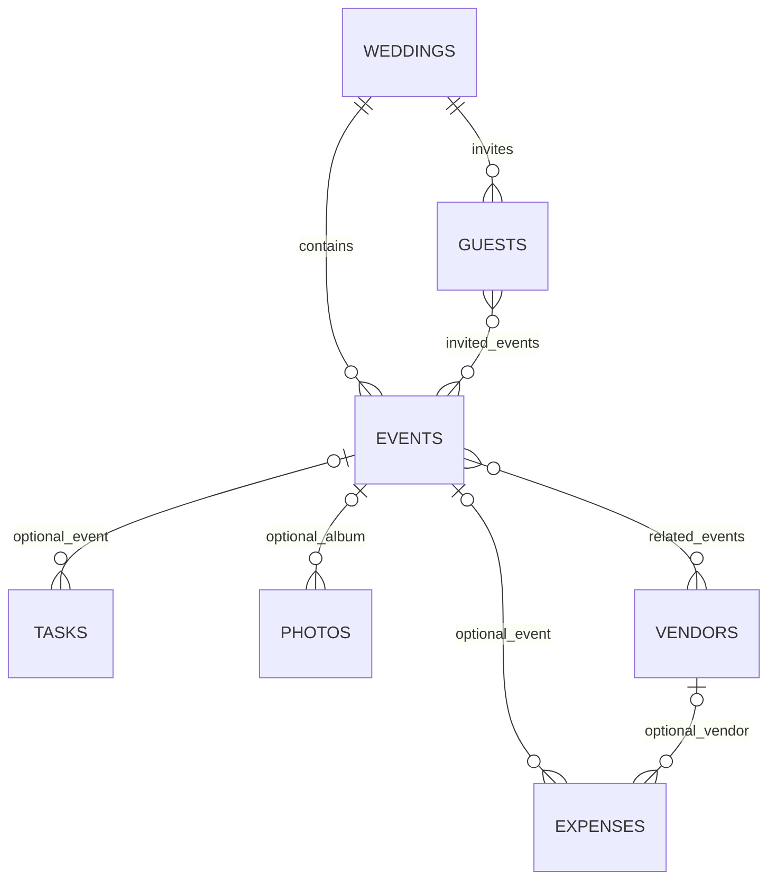
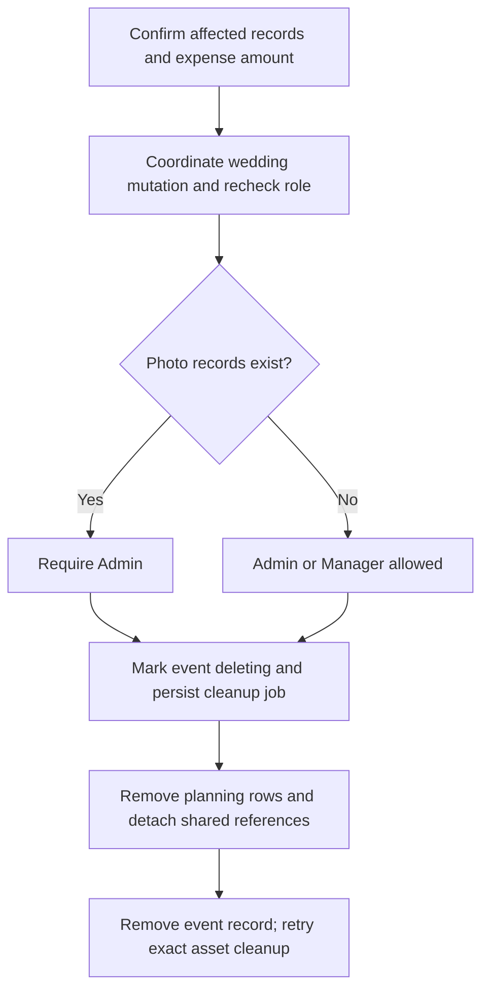

# KalyanaPura V1 — Database Design

**Version:** 1.0  
**Date:** 9 October 2026  
**Status:** Implementation design; no database has been provisioned or modified  
**Inputs:** KalyanaPura V1 PRD, agreed product clarifications, and System Design Architecture v1.0

## 1. Purpose and design decision

Use one MongoDB database in the managed MongoDB Atlas cluster. The full-stack Next.js application accesses it through the official MongoDB Node.js driver. Better Auth uses its MongoDB adapter and owns the authentication records. The application owns wedding membership and planning records.

This document specifies collections, document fields, relationships, validation, indexes, read patterns, transactions and recovery rules. API contracts, final screen layouts and hosting selection remain separate design stages.

The family-facing product stays simple. A guest record contains one invitation and one overall RSVP. Website and gallery settings are embedded in the wedding. Albums are derived from events. Technical upload and job records protect data when external services fail; they do not introduce additional product screens.

### 1.1 Main decisions

| Decision | Reason |
|---|---|
| One database shared by weddings; every wedding-owned document carries `weddingId` | Simple deployment with an explicit boundary between families |
| Reference growing lists; embed small settings and one-to-one information | Avoid a giant wedding document while keeping related updates straightforward |
| Separate member records from Better Auth users | Being logged in and belonging to a wedding are different facts |
| Embed invitation and RSVP in each guest | One invitation and one response per guest; fewer joins and fewer records to keep consistent |
| Keep vendor records when events are deleted | Contacts remain useful independently of an event |
| Store image metadata in MongoDB and image bytes in Cloudinary | Database queries remain small; no image binaries or GridFS |
| Store amounts as integer paise using BSON `Long` | Exact INR arithmetic without floating-point rounding |
| Use short transactions and one coordination write per wedding mutation | Protect membership, permissions and references during simultaneous actions |
| Use durable jobs and upload reservations | Recover failed dispatch, interrupted uploads and external asset cleanup |
| Calculate dashboard totals from current records | Avoid maintaining a second copy of RSVP, task and expense totals |

**Recommended data-access approach:** use the native driver for application collections as well as the Better Auth adapter. An additional ODM is not required for V1. Use shared application validators and MongoDB collection validators instead. This is an implementation recommendation, not a change to the product.

## 2. Product rules the database must preserve

1. An account has at most one current wedding membership. The wedding date does not end that membership.
2. A wedding must retain at least one active Admin. Manager is the default invited role.
3. Member invitations are bound to an email address and expire seven days after issue or resend. Guests do not need accounts.
4. A guest has one invitation, selected invited events, one overall RSVP and a maximum total party size that includes the named guest.
5. Guest name is required. Guest email and phone are optional. Neither identifies a guest uniquely.
6. Guest invitation links do not expire automatically on the wedding date. Replacing or disabling a link invalidates its existing capabilities.
7. A valid gallery grant covers all wedding albums, regardless of the events on the invitation. Guest viewing and uploading can be independently enabled.
8. Only Admins delete photos. An event containing photo records requires an Admin to delete it. Managers can delete events without photos.
9. Event deletion removes associated tasks, expenses and photos, detaches vendor/event associations and removes the event from invitations and website content. Guests and vendors remain.
10. Unpublishing the website does not disable invitations or gallery access. Renaming the couple does not change the chosen website address.
11. Saved changes appear through the existing links. Event edits and deletion do not automatically send emails.
12. My Vendors stores manually entered information. External Google Maps discovery does not create a Places cache or import business data.

There are no budgets, bookings, payment schedules, per-event RSVPs, guest accounts, independent album management, real-time collaboration or user-facing activity logs in this design.

## 3. Collection inventory

### 3.1 Better Auth-owned collections

These are logical core model names. Keep the pinned adapter's native collection mapping and field representation; verify physical names in the implementation rather than assuming plural names.

| Logical collection | Purpose | Writer |
|---|---|---|
| `user` | Member identity, email verification and profile | Better Auth |
| `session` | Database-backed login sessions | Better Auth |
| `account` | Credential authentication method and password hash | Better Auth |
| `verification` | Verification/reset mechanisms | Better Auth |

Do not duplicate these in application `users` or `passwords` collections.

### 3.2 Application-owned collections

| Collection | Stores | Expected growth |
|---|---|---|
| `weddings` | Wedding identity, presentation/settings and media quota | One per wedding |
| `wedding_members` | Current Admin/Manager membership | One current record per member account |
| `member_invitations` | Current email-bound membership invitation | One per wedding and normalized invited email |
| `events` | Wedding events | Small list per wedding |
| `tasks` | Planning tasks | Growing list per wedding |
| `guests` | Guest, invitation capability and RSVP | Growing list per wedding |
| `vendors` | Selected vendor contacts and event links | Growing list per wedding |
| `expenses` | Expense entries | Growing list per wedding |
| `photos` | Image metadata, protected previews and cover assets | Largest product collection |
| `upload_reservations` | Authorized upload/copy attempts and quota ownership | Temporary, with safe cleanup |
| `background_jobs` | Durable email and cleanup work | Temporary operational records |
| `system_state` | Provider-account-wide media quota | A small fixed set |
| `rate_limits` | Durable, bounded request/send counters | Short-lived windows |
| `schema_migrations` | Applied application schema/index changes | Small append-only technical list |

Four authentication models and fourteen application collections serve one application. Collection count does not imply separate services or deployments.

### 3.3 Collections deliberately avoided

| Not created | Replacement |
|---|---|
| `albums` | An active event is an album; `eventId: null` means Wedding Memories |
| `rsvps` | Embedded in `guests.rsvp` |
| `guest_invitations` | Embedded in `guests.invitation` |
| `websites` | Embedded in `weddings.website` |
| `qr_codes` | Generate from the canonical gallery URL; do not persist QR image bytes |
| `vendor_discovery_results` | Open Google Maps; chosen vendors are entered manually |
| `payments`, `budgets`, `notifications`, `activity_logs` | Outside V1 |

## 4. Modeling conventions

### 4.1 IDs and common fields

Application entity IDs are BSON `ObjectId`. API design will serialize them as strings; database queries must parse and validate them before use.

An application `userId` is a **string containing exactly the canonical ID returned by Better Auth**. Do not assume it has the same BSON type as the adapter's underlying `_id`, manually convert it to `ObjectId`, or invent a second account ID. Adapter-specific joins must use the verified mapping.

Unless a collection says otherwise, application product records contain:

| Field | BSON type | Rule |
|---|---|---|
| `_id` | ObjectId | Generated by the server; immutable |
| `weddingId` | ObjectId | Required on wedding-owned records; immutable |
| `schemaVersion` | Int32 | Required; starts at `1`; changes only through migrations |
| `version` | Int32 | Required; starts at `1`; increments on business changes |
| `createdAt` | Date | Required; server UTC timestamp; immutable |
| `updatedAt` | Date | Required; server UTC timestamp of business change |

`weddings` uses its `_id` as the wedding identifier and does not repeat `weddingId`. Operational collections define their own fields below. Their bookkeeping can update without changing a product record's business revision.

In field tables, **Required** means the key exists. A required nullable field is explicitly `null` when unused. Optional means the key may be absent. Never mix missing, empty strings and `null` as equivalent states for the same field.

### 4.2 Dates, time and currency

| Information | Storage | Interpretation |
|---|---|---|
| Wedding day | `YYYY-MM-DD` string | A calendar day in `Asia/Kolkata`; not midnight UTC |
| Event start/end | BSON Date | Actual UTC instants; render in the wedding timezone |
| Task due day | Nullable `YYYY-MM-DD` string | A date-only deadline; no invented time of day |
| Expense day | `YYYY-MM-DD` string | Date entered by the organiser |
| Expiry, lease, upload and audit timestamps | BSON Date | Compared against server UTC time |
| Currency | Literal `INR` | Fixed for V1 |
| Expense and agreed vendor cost | BSON Long, in paise | ₹1,250.50 is `125050` paise |

Parse rupee input as a decimal string into integer paise, reject more than two decimal places and negative values, then construct BSON `Long`. Do not calculate `Number(input) * 100`. Serialize money to an exact string representation in the future API. Aggregate using an exact type; converting paise to `Decimal128` before summing avoids a large total overflowing a signed 64-bit integer.

Use BSON `Long` for stored byte counters. Validate safe conversion at the driver boundary; never silently round an amount or byte count. BSON's Date, ObjectId, Long and Decimal128 types are distinct storage types, not interchangeable JSON strings/numbers. [S10]

### 4.3 Validation and bounded data

Recommended initial limits are technical safeguards, not a redesign of the approved features:

| Input | Initial validation limit |
|---|---|
| Names, event names, task/expense titles | 1–150 trimmed characters |
| Wedding title | Optional; at most 150 characters |
| Descriptions, welcome text and private notes | At most 5,000 characters each |
| Venue/address | At most 500 characters each |
| Category | 1–60 characters; use suggested labels in the UI |
| Email | At most 254 characters; validate format when supplied |
| URL | At most 2,048 characters; allow only permitted schemes/hosts for its purpose |
| Selected event IDs on guest/vendor | Unique IDs; no more than the configured maximum events per wedding |
| Photo selection | At most 20 files per batch; 10,000,000 bytes per original file |
| Bulk email request | At most 200 selected guest IDs per durable request; split larger selections |

Normalize emails by trim and lowercase using the same convention as the configured auth system. Do not remove Gmail dots or plus suffixes. Retain phone numbers as bounded strings; normalizing an optional number does not make it an identity or enable automated messaging.

Use application validation for calendar validity, timezone conversion, URL rules, token generation, cross-document ownership and permissions. Use MongoDB validators for BSON types, required fields, allowed states, numeric ranges and relevant within-document constraints. MongoDB does not provide application foreign-key enforcement.

## 5. Relationships and embedding

The diagram shows planning relationships, not authorization grants. Every reference must belong to the same wedding.



Guests and vendors use **bounded arrays of event IDs**. Tasks, expenses and gallery photos use one nullable event ID. A task's optional assignee references a membership record, not just an account; an old membership cannot regain task ownership after leaving and rejoining.

Small one-to-one information is embedded: website settings in the wedding, RSVP in the guest, and provider metadata in the photo. Do not embed all guests, photos, tasks or expenses in `weddings`, and do not maintain duplicate reverse-ID arrays on events.

## 6. Authentication boundary

Better Auth owns the core schema and credential lifecycle. Its logical user includes identity/email fields; sessions link a user and expiry; accounts link a provider identity and credential hash; verification records hold identifiers, values and expiry. Follow the installed adapter rather than recreating those models. [S1][S2]

### 6.1 Integration contract

| Concern | Required behavior |
|---|---|
| Adapter setup | Use the shared MongoDB database/client; pass the client for adapter transactions on the chosen replica-set environment |
| Member login | Email/password with verified email ownership |
| Session | Database-backed; seven-day absolute lifetime; authoritative checks without stale cookie-cache authorization |
| Membership | Read `wedding_members` on each protected request; never trust a wedding role supplied by the browser |
| Role scope | Admin/Manager belongs to a wedding, not to Better Auth's global user profile |
| Password reset | Use Better Auth; revoke existing sessions through its supported mechanisms |
| Account deletion | Do not enable self-service auth-account deletion in V1; it must not bypass membership cleanup or the last-Admin rule |
| Index/validator ownership | Verify the pinned adapter's required fields, indexes and ID representation before adding restrictions |

Acceptance at implementation: sign up, duplicate-email rejection, login, verification, reset, session expiry and canonical ID mapping must work against the configured MongoDB adapter. This gate protects the auth boundary; it does not defer the application `userId` convention.

Expected auth access paths include unique email lookup, unique session-token lookup, sessions by user, credential identity by provider/account, and verification lookup/expiry. Ensure the adapter's index setup supports them. Do not add a custom unique verification-value constraint or restrictive application validator to auth collections without checking the actual adapter.

## 7. `weddings`

One document owns wedding identity, small settings and the coordination point for changes. Common fields apply, except `weddingId`.

| Field | Type | Required / default | Meaning |
|---|---|---|---|
| `brideName`, `groomName` | String | Required | Couple names |
| `weddingDate` | String | Required | Valid local calendar day |
| `location` | String | Required | Wedding city/location |
| `title`, `description` | String or null | Required / null | Optional presentation content |
| `createdByUserId` | String | Required | Original creator; informational, not permanent ownership |
| `status` | String | Required / `active` | V1 uses `active`; wedding date does not archive the wedding |
| `timezone`, `currency` | String | Required / `Asia/Kolkata`, `INR` | Fixed V1 settings |
| `coverPhotoId` | ObjectId or null | Required / null | Ready `wedding_cover` photo owned by this wedding |
| `website.slug` | String or null | Required / null | Lowercase stable address; set once when chosen |
| `website.theme` | String | Required / `minimal_elegant` | `classic_indian`, `minimal_elegant`, `modern_celebration` |
| `website.welcomeText` | String | Required / empty | Public welcome content |
| `website.isPublished` | Boolean | Required / false | Public website availability |
| `website.firstPublishedAt` | Date or null | Required / null | Set on first publication; retain after unpublishing |
| `website.updatedAt` | Date | Required | Last website-setting change |
| `livestream.youtubeVideoId` | String or null | Required / null | Validated video identifier; no iframe HTML |
| `gallery.guestViewEnabled` | Boolean | Required / true | Guest album/media viewing and downloads |
| `gallery.guestUploadEnabled` | Boolean | Required / true | Guest uploads; independent of viewing |
| `gallery.tokenHash` | String | Required | SHA-256 hex digest of random shared gallery token |
| `gallery.tokenCiphertext` | Object | Required | Encrypted token for copying/reprinting the same link |
| `gallery.tokenVersion` | Int32 | Required / 1 | Technical capability version; no routine rotation UI |
| `gallery.uploadPolicyVersion` | Int32 | Required / 1 | Increment on guest upload-setting changes; fences old reservations |
| `mediaQuota.limitBytes` | Long | Required | Configured positive or zero capacity; zero blocks new reservations |
| `mediaQuota.usedBytes` | Long | Required / 0 | Known provider assets still held by this wedding |
| `mediaQuota.reservedBytes` | Long | Required / 0 | Outstanding capacity held for authorized operations |
| `writeFence` | Long | Required / 0 | Coordination counter; see Section 19 |

The guest-view/upload defaults and default theme are implementation baselines; either organiser role can change the feature settings. No cap value is silently chosen here: deployment must initialize explicit wedding and provider-account limits before uploads are enabled.

**Public event selection lives on `events.isPublic`.** Do not store a second `website.eventIds` array. One source of truth makes event edits and deletion straightforward.

Validate a chosen slug as 3–80 lowercase letters/digits/hyphens, matching `^[a-z0-9]+(?:-[a-z0-9]+)*$`; reject reserved route names as defined by the later URL layout. Never derive a new slug on a name edit. A unique-index conflict returns a request to choose another address.

Do not return the wedding document wholesale to public pages: token material, quota data, creator identity and internal metadata remain private.

## 8. `wedding_members`

Only current or currently-being-removed membership records exist. There is no product membership-history collection.

| Field | Type | Required / default | Rule |
|---|---|---|---|
| `userId` | String | Required | Canonical Better Auth user ID |
| `role` | String | Required | `admin` or `manager` |
| `status` | String | Required / `active` | `active` or `removing` |
| `joinedAt` | Date | Required | Membership start |
| `invitedByUserId` | String or null | Required / null | Null for wedding creator |
| `removalStartedAt` | Date or null | Required / null | Set only while leaving/removal cleanup runs |

**Unique index on `userId` across the collection** enforces at most one current membership, including a membership whose cleanup is still running. This is intentionally stronger than checking only `status: active`; it prevents another wedding being joined midway through departure cleanup.

An inactive/removing membership grants no access. Tasks with an assignee whose membership is not active display as unassigned immediately. A retryable job clears those task references and then removes the membership document. A later rejoin creates a new membership ID, so earlier task references cannot silently become active again.

For member lists and assignee pickers, batch-resolve only allowed profile fields such as display name through the verified auth ID mapping. Do not copy passwords/sessions into membership records or expose entire auth documents; there is no need to keep a second editable profile here.

The last-Admin rule is enforced in the coordinated transaction, not by this unique index. Do not store an independent `adminCount` field that can drift.

## 9. `member_invitations`

Store the current invitation per wedding and invited email; resend replaces its token and renews its seven-day acceptance window.

| Field | Type | Required / default | Rule |
|---|---|---|---|
| `emailNormalized` | String | Required | Bound to verified recipient email |
| `role` | String | Required / `manager` | `admin` or `manager` |
| `invitedByUserId` | String | Required | Current Admin must authorize issue/resend |
| `tokenHash` | String | Required | Current token lookup digest |
| `tokenCiphertext` | Object or null | Required | Encrypted copy for the current pending link |
| `tokenVersion` | Int32 | Required / 1 | Increment on resend/replacement |
| `status` | String | Required / `pending` | `pending`, `accepted`, `revoked` |
| `issuedAt`, `expiresAt` | Date | Required | `expiresAt = issuedAt + 7 days` |
| `acceptedByUserId` | String or null | Required / null | Only set on successful acceptance |
| `acceptedAt` | Date or null | Required / null | Only set on successful acceptance |

Expired means `status: pending` and `expiresAt <= now`; it need not be a separately maintained status. Expiry is checked in the application even if the record still exists. Do not use TTL to implement authorization or to make acceptance/resend correctness depend on background deletion.

A unique `(weddingId, emailNormalized)` index prevents competing current invitations for the same wedding/email. It does not block invitations from other weddings; only accepting membership enforces the one-wedding account rule.

After acceptance, clear retained token ciphertext. Keep the compact accepted record until it is replaced or deliberately removed; a repeat acceptance can report the already-joined state for the same account. It must never recreate membership after that account has left. Resend/reinvite requires a fresh authorized action and a new token version.

## 10. `events`

| Field | Type | Required / default | Rule |
|---|---|---|---|
| `name` | String | Required | Editable event name; duplicates are allowed |
| `type` | String | Required / `custom` | Suggested event label or custom |
| `startsAt` | Date | Required | UTC instant derived from the entered local date/time |
| `endsAt` | Date or null | Required / null | If supplied, later than `startsAt`; may cross midnight |
| `venueName`, `address` | String or null | Required / null | Entered venue information |
| `description`, `dressCode` | String or null | Required / null | Event presentation content |
| `coverPhotoId` | ObjectId or null | Required / null | Ready `event_cover` belonging to this event |
| `isPublic` | Boolean | Required / false | Included on the public website when published |
| `status` | String | Required / `active` | `active` or `deleting` |
| `deletionStartedAt` | Date or null | Required / null | Internal deletion marker |
| `createdByUserId` | String | Required | Informational creator reference |

The event form supplies a start time; any design for an event with no specified time must explicitly change this contract in the later UI/API design. Do not store a fake midnight to imply a time the organiser did not choose.

No event contains embedded task, guest, vendor, expense or photo lists. Event schedules are not constrained to the main wedding day; a reception may occur later.

## 11. `tasks`

| Field | Type | Required / default | Rule |
|---|---|---|---|
| `title` | String | Required | Task title |
| `description` | String or null | Required / null | Optional details |
| `eventId` | ObjectId or null | Required / null | Active event in this wedding, when set |
| `assigneeMembershipId` | ObjectId or null | Required / null | One active membership in this wedding |
| `dueDate` | String or null | Required / null | Valid local calendar day |
| `priority` | String | Required / `medium` | `low`, `medium`, `high` |
| `status` | String | Required / `todo` | `todo`, `in_progress`, `completed` |
| `completedAt` | Date or null | Required / null | Set when completed; clear when reopened |
| `createdByUserId` | String | Required | Creator; not exclusive editing authority |

Any current member can edit a task. An assignee indicates responsibility, not ownership permissions. No task comments, attachments, dependency graphs or subtasks are stored.

## 12. `guests`

One record holds one invitation and one RSVP. Common fields apply.

| Field | Type | Required / default | Rule |
|---|---|---|---|
| `name` | String | Required | Named guest; not unique |
| `nameNormalized` | String | Required | Server-maintained search/sort value; never an identity |
| `emailNormalized` | String or null | Required / null | Optional contact email |
| `phone` | String or null | Required / null | Optional contact number |
| `maxPartySize` | Int32 | Required / 1 | At least 1; configured upper bound; includes named guest |
| `invitedEventIds` | Array of ObjectId | Required / empty | Unique active event IDs in the same wedding |
| `notes` | String or null | Required / null | Organiser-only notes |
| `invitation.tokenHash` | String | Required | Random personal invitation digest |
| `invitation.tokenCiphertext` | Object | Required | Encrypted current token for copy/resend |
| `invitation.tokenVersion` | Int32 | Required / 1 | Increment on replacement and capability revocation |
| `invitation.enabled` | Boolean | Required / true | Whether guest capabilities from this invitation are usable |
| `invitation.issuedAt` | Date | Required | Current token generation time; no automatic expiry |
| `rsvp.status` | String | Required / `pending` | `pending`, `attending`, `not_attending` |
| `rsvp.partySize` | Int32 | Required / 0 | Attending: 1 through `maxPartySize`; otherwise 0 |
| `rsvp.respondedAt` | Date or null | Required / null | Last response/update; null for an untouched Pending record |
| `rsvp.updatedByKind` | String or null | Required / null | `guest` or `member` |
| `rsvp.updatedByUserId` | String or null | Required / null | Only for a member update |
| `importRequestId`, `importRowNumber` | String, Int32 | Optional, together | Stable identity of an imported source row; no automatic email |
| `createdByUserId` | String | Required | Organiser who created/imported the record |

### 12.1 Guest and RSVP validation

- Do not create a unique email, name or phone index. Family members may share contact details, and contact fields may be absent.
- Guest edits and guest-link RSVP updates both validate the current `maxPartySize`. If an edit lowers the maximum below the existing attendance, reject it unless the same atomic edit supplies a corrected response.
- A duplicate submission updates the existing record; it does not insert a second RSVP or increment a stored attendance counter.
- Draft guests may have no invited events. If deletion removes their final event, retain the guest, link and current RSVP. Show an invitation with no available events and disable new guest Attending submissions until an active event is selected. Do not silently rewrite the saved response. Organisers can correct it explicitly.
- Invite-only selected events are resolved live. Do not duplicate event names, dates or venue descriptions into the guest record.
- Invitation replacement atomically changes the token hash/ciphertext and increments its version. Existing grants and queued messages tied to the old version become ineligible.

### 12.2 Import behavior

Use one validated CSV format with preview and row errors. Save bounded batches with a server-issued `importRequestId` and source-row number. A partial unique index makes retrying the same import row safe. Do not deduplicate different rows by name or email, and do not automatically merge separate imports; any duplicate warnings are advisory. Imported rows do not send invitations.

## 13. `vendors`

| Field | Type | Required / default | Rule |
|---|---|---|---|
| `name`, `nameNormalized` | String | Required | Entered name and server-derived sort/search value |
| `category` | String | Required | Suggested vendor label, with `other` available |
| `contactPerson`, `phone`, `emailNormalized` | String or null | Required / null | Optional contact information |
| `address`, `websiteUrl`, `notes` | String or null | Required / null | Optional manually entered information |
| `agreedCostPaise` | Long or null | Required / null | Optional nonnegative agreed cost; not an expense entry |
| `eventIds` | Array of ObjectId | Required / empty | Unique active events in this wedding |
| `status` | String | Required / `active` | `active` or `deleting`; deletion retains expenses while detaching links |
| `createdByUserId` | String | Required | Informational creator reference |

Suggested labels cover photographer, videographer, venue, caterer, decorator, DJ, makeup artist, Mehendi artist, Pandit, choreographer, florist, wedding planner, transport and other. Keep suggestion lists in application code, not a category-management collection.

No Google place ID, rating, distance, scraped result, booking state or instalment schedule is required. Event deletion pulls only the deleted event ID from `eventIds`. Vendor deletion detaches its reference from retained expenses instead of deleting those expenses.

## 14. `expenses`

| Field | Type | Required / default | Rule |
|---|---|---|---|
| `title` | String | Required | Expense label |
| `amountPaise` | Long | Required | Nonnegative exact amount within the configured per-entry bound |
| `expenseDate` | String | Required | Valid local calendar day |
| `category` | String | Required | Suggested expense label, with miscellaneous available |
| `eventId`, `vendorId` | ObjectId or null | Required / null | Optional same-wedding relationships |
| `notes` | String or null | Required / null | Organiser-only note |
| `createdByUserId` | String | Required | Informational creator reference |

Suggested categories are venue, catering, photography, videography, decoration, clothing, jewellery, entertainment, invitations, gifts, travel, makeup and miscellaneous. Do not store derived totals, budget limits, payment balance or variance.

If the related event is deleted, delete the expense record as agreed, even if its amount represents money already paid. The deletion confirmation must show the amount being removed. If only a vendor is deleted, set `vendorId` to null and retain the expense.

## 15. `photos`

Store metadata for gallery originals and deliberately selected website covers. The image bytes remain in Cloudinary. Common fields apply.

| Field | Type | Required / default | Rule |
|---|---|---|---|
| `kind` | String | Required | `gallery`, `wedding_cover`, `event_cover` |
| `eventId` | ObjectId or null | Required / null | Gallery album or event cover owner; null for Wedding Memories/wedding cover |
| `uploadReservationId` | ObjectId | Required | Unique initial upload operation |
| `status` | String | Required | `ready` or `delete_pending` |
| `original` | Object | Required | Protected Cloudinary asset metadata; shape below |
| `previews` | Array of object | Required; at least one | Bounded, pre-generated permitted transforms; ready photos have a usable preview |
| `publicCoverAsset` | Object or null | Required / null | Separate sanitized public rendition; covers only |
| `storageBytes` | Long | Required | Known bytes retained across original, fixed derivatives and public copy |
| `uploadedBy.kind` | String | Required | `member` or `guest` |
| `uploadedBy.userId` | String or null | Required / null | Member uploader only |
| `uploadedBy.membershipId` | ObjectId or null | Required / null | Membership at upload time |
| `uploadedBy.guestId` | ObjectId or null | Required / null | Only if access came from a personal invitation |
| `uploadedAt` | Date | Required | Trusted upload completion time |
| `readyAt`, `deletionRequestedAt` | Date or null | Required / null | Lifecycle timestamps |

`uploadedBy` is internal provenance, not a promise that an anonymous guest's identity was verified. Shared-gallery uploads need no name, email or persistent guest account. Internal uploader references may outlive a deleted guest or removed membership and do not grant access.

### 15.1 Provider metadata

An asset object contains `assetId`, `publicId`, `version`, `resourceType: image`, `deliveryType`, `format`, `bytes`, `width`, and `height`. Delivery is `authenticated` for originals and protected previews. A preview additionally identifies one server-approved transformation and its byte size; it is not an arbitrary client-supplied transform URL.

Persist provider identifiers, not reusable signed URLs. Generate provider requests server-side after access checks. A `publicId` is not an authorization check. `previews` has a small configured maximum, initially three variants; its identifiers/byte accounting are verified against actual provider responses.

### 15.2 Public covers and private gallery separation

Gallery assets stay authenticated. Never make a gallery original public because someone chooses it as a cover. Cover workflows produce a **separate public rendition** with location metadata removed. Private original/preview delivery continues through the protected media route.

Before first publication, preview cover media through the member-authorized route. Prepare any necessary public cover copy outside a database transaction, using a recorded reservation and deterministic provider identifier; commit publication only after the selected cover rendition is ready and still matches the current selection. Website readers get only explicit public cover metadata. A published site's later cover change likewise commits the new selection only after its public rendition is ready; ordinary text/event edits become live on save.

There is at most one current `publicCoverAsset` per cover photo. Its metadata also contains `status: ready | deleting`. Reuse a ready rendition; do not overwrite it with a second concurrent copy. Atomically attach a new copy only when the slot is null. A competing unused copy is cleaned up through its reservation without transferring a second charge.

Unpublishing blocks new website reads; it cannot recall an already downloaded or cached public cover. Superseded public copies can be cleaned up when no longer referenced: mark the exact public asset deleting under the wedding coordination write, persist a `public_cover_only` cleanup target, and do not publish/reselect it until cleanup or regeneration finishes. On confirmed deletion, clear that slot and reduce the photo and quota byte charges once. The protected original remains until authorized photo deletion. Never expose gallery-token material in a cover or website response.

### 15.3 Visibility and deletion

Gallery reads include only `kind: gallery`, `status: ready`, and either `eventId: null` or an active event in the same wedding. While verification/previews are preparing, the reservation holds capacity and no photo record is visible or charged as accepted. Insert a ready photo only in the final quota-transfer transaction; there is no human moderation queue.

Deleting a photo changes it to `delete_pending` and creates durable asset-cleanup work in the same transaction. It disappears from normal reads immediately. Clear any current wedding/event cover pointer in that transaction. Keep the record and its quota charge until original/derived/public assets have been deleted or authoritatively confirmed absent. Then remove the record and release its charge exactly once.

An event with ready or delete-pending photo records counts as containing photos for the Admin-only deletion check. A bare upload reservation with no photo record does not require Admin event deletion; it is invalidated and its unpublished asset cleaned up internally.

## 16. `upload_reservations`

A reservation records one backend-authorized asset operation. It is created before a browser receives upload parameters or a background cover-copy call creates a provider asset.

| Field | Type | Required / default | Rule |
|---|---|---|---|
| `_id`, `weddingId` | ObjectId | Required | Operation and owner |
| `schemaVersion` | Int32 | Required / 1 | Operational document format |
| `purpose` | String | Required | `photo_upload` or `public_cover_copy` |
| `targetKind`, `eventId` | String, ObjectId or null | Required | Intended photo kind and optional active event |
| `photoId` | ObjectId or null | Required / null | Existing photo for cover-copy; set after initial photo creation |
| `actor` | Object | Required | Member membership/user, invitation guest/version, or shared gallery version |
| `uploadPolicyVersion` | Int32 or null | Required | Capture for guest uploads; null for member-only cover work |
| `providerPublicId`, `deliveryType` | String | Required | Server-selected unique target; overwrite disabled |
| `reservedBytes` | Long | Required | Conservative original/copy plus permitted derivative allowance |
| `state` | String | Required / `reserved` | `reserved`, `committed`, `cleanup_pending`, `cleaned` |
| `quotaState` | String | Required / `held` | `held`, `transferred`, `released` |
| `expiresAt` | Date | Required | Application acceptance deadline |
| `providerExpiresAt` | Date | Required | Actual provider capability validity boundary, verified by the adapter |
| `cleanupNotBefore` | Date | Required | Provider validity plus configured settlement safety margin |
| `providerAssetId` | String or null | Required / null | Set when known |
| `failureCode` | String or null | Required / null | Safe operational reason; no raw secrets |
| `createdAt`, `updatedAt` | Date | Required | UTC timestamps |
| `purgeAt` | Date | Optional | Only after terminal safe cleanup/transfer and retention window |

Generate unpredictable provider identifiers from a reservation ID plus server-random material. Do not use names/phone numbers in provider folders or identifiers. Do not persist upload signatures as long-lived records.

One selected batch creates up to twenty per-file reservations. Each file succeeds or fails independently; a failed file does not restart completed files.

**No TTL on `expiresAt`.** Application expiry ends acceptance, but does not prove a provider upload cannot still finish. Keep quota held during cancellation/cleanup until the provider validity/settlement window is over and outstanding assets have been resolved. Reconciliation checks the recorded target for late assets. A deployment adapter must establish the actual validity and completion behavior; it must not invent a short provider expiry because the application uses a shorter deadline.

These counters bound accepted/reserved application assets, not every possible provider billing metric. Provider-account monitoring and conservative headroom remain necessary; MongoDB cannot revoke a previously issued third-party upload capability or guarantee the provider's exact billed usage.

## 17. `background_jobs`

This is a small operational work store and dispatch record. Inngest coordinates executions. It is not a general workflow engine, notification centre or product activity log.

### 17.1 Common job fields

| Field | Type | Required / default | Rule |
|---|---|---|---|
| `_id` | ObjectId | Required | Job identity |
| `schemaVersion` | Int32 | Required / 1 | Operational document format |
| `weddingId` | ObjectId or null | Required | Null only for account verification/reset email |
| `kind` | String | Required | `email_request`, `email`, `verify_upload`, `delete_media`, `delete_event`, `remove_member`, `delete_vendor` |
| `dedupeKey` | String | Required | Globally unique, namespaced operation identity |
| `requestFingerprint` | String | Required | Hash of canonical intended parameters; rejects key reuse with different input |
| `requestedByUserId` | String or null | Required | Account actor, or null for narrow system cleanup |
| `target` | Object | Required | Minimal IDs and captured versions; per-kind shape |
| `state` | String | Required / `queued` | `queued`, `running`, `succeeded`, `failed`, `cancelled` |
| `dispatchState` | String | Required / `pending` | `pending` or `published`; redispatch remains safe |
| `dispatchAttempts`, `attempts` | Int32 | Required / 0 | Bounded attempt counters |
| `nextDispatchAt`, `availableAt` | Date | Required | Retry/eligibility scheduling |
| `leaseToken` | String or null | Required / null | Fresh random claim token |
| `leaseUntil` | Date or null | Required / null | Worker lease; not TTL |
| `leaseRevision` | Long | Required / 0 | Real coordination increment when committing product changes |
| `phase`, `cursor` | String/object or null | Required / null | Bounded cleanup progress; shape depends on kind |
| `lastErrorCode` | String or null | Required / null | Safe error category |
| `createdAt`, `updatedAt` | Date | Required | UTC timestamps |
| `finishedAt` | Date or null | Required / null | Set on terminal work outcome |
| `purgeAt` | Date | Optional | Only after safe retention requirements are met |

### 17.2 Per-kind target/payload contract

| Kind | Stored target/payload | Completion means |
|---|---|---|
| `email_request` | Request UUID, message type, up to 200 guest IDs, captured recipient/token versions | Child email records durably exist; does not mean delivery |
| `email` | Guest/member-invitation reference and version, or encrypted auth-email payload | Provider acceptance recorded, or explicit terminal failure/cancellation |
| `verify_upload` | Reservation ID | Metadata verified and accepted photo committed, or cleanup scheduled |
| `delete_media` | Mode `whole_photo`, `public_cover_only` or `reservation_asset`; photo/reservation ID and exact asset identifiers | Selected assets resolved and only their charge released/transfer confirmed |
| `delete_event` | Event ID and cleanup phase | Product references/linked planning rows removed and photo cleanup scheduled |
| `remove_member` | Membership ID and cleanup cursor | Task references cleared and membership removed |
| `delete_vendor` | Vendor ID and cleanup cursor | Expense references detached and vendor removed |

An explicit resend has a new request UUID. A retry of the same UI request retains its UUID and fingerprint. Child email dedupe keys include the parent request and target guest; retrying parent expansion cannot insert duplicate child work.

### 17.3 Email-specific fields

Email jobs additionally contain `email.type`, `email.providerMessageId` (nullable), `email.idempotencyKey`, `email.payloadCiphertext` (nullable until rendered), `email.firstAttemptAt`, `email.retryDeadlineAt`, and `email.evidence` with nullable `acceptedAt`, `deliveredAt`, `bouncedAt`, `complainedAt` and `failedAt` timestamps.

Render and freeze the exact recipient/subject/body for the first provider attempt. Encrypt the payload because it can contain contact information and bearer links. Retries use that same payload and key. Before sending, recheck that the captured invitation version, recipient email and required actor/guest state remain eligible; never send a newly rendered body under an old idempotency key.

Work completion and delivery are separate. A successful `email` job may mean provider acceptance while its delivery evidence later records a bounce. Keep evidence fields independent and idempotent; deriving a display state must not let a late accepted callback overwrite a delivered/bounced outcome.

Resend's documented idempotency window is currently 24 hours. Set a conservative retry deadline from the first attempt with a safety margin. Stop ambiguous automatic retries beyond that window; record uncertainty/failure and require an intentional new resend rather than claiming exactly-once delivery. [S7]

For unknown signed provider message IDs, do not update an arbitrary job. Allow a bounded retry when the provider ID has not yet been persisted; monitor unresolved callbacks and reconcile accepted sends. Do not store unrestricted webhook bodies or bearer tokens in logs.

### 17.4 Claim and dispatch rules

Claim due queued work, or running work whose lease expired, with one conditional `findOneAndUpdate`. Set a fresh `leaseToken`, bounded `leaseUntil` and increment `attempts`. All progress/completion writes include that token. An old worker may not commit results after another worker has acquired the job.

For product-changing job transactions, require the current token and an unexpired lease, and increment `leaseRevision` in the same transaction as the product changes; a lease check performed only before the transaction is insufficient. External calls still require provider idempotency or deterministic target identifiers because MongoDB leases do not make external operations exactly once.

The job row is written in the same transaction as the action requesting it. After commit, publish its ID to Inngest. If publication fails or a process stops, pending dispatch remains discoverable. Reconciliation retries dispatch and expired leases. Do not rely on an in-memory timer or a process staying awake.

Auth verification/reset email intent is persisted by an awaited Better Auth email hook. Do not pretend that hook's job insert and Better Auth's credential/token writes automatically share an application transaction. On hook failure, surface retryable auth-email failure; retries/resends follow Better Auth's token rules.

## 18. `system_state`, `rate_limits` and `schema_migrations`

### 18.1 Provider-account media capacity

`system_state` contains a singleton media document:

| Field | Type | Meaning |
|---|---|---|
| `_id` | String | `media:cloudinary` |
| `schemaVersion` | Int32 | Starts at 1 |
| `limitBytes`, `usedBytes`, `reservedBytes` | Long | Account-wide configured capacity and held usage |
| `uploadsEnabled` | Boolean | Operator-controlled stop for new reservations |
| `writeFence` | Long | Coordination counter |
| `updatedAt` | Date | Quota/configuration change timestamp |

This is the quota for the application's configured Cloudinary account, not a separate free allowance per wedding. No provider secret is stored here. A zero/uninitialized capacity does not mean unlimited uploads.

### 18.2 Durable limits

`rate_limits` stores `_id: ObjectId`, unique `bucketKey`, `scopeHash`, `action`, `windowStartsAt`, `windowEndsAt`, `count: Int32`, `createdAt` and `purgeAt`. Optional `weddingId` identifies a wedding-scoped bucket.

Use an HMAC of sensitive subject identifiers for `scopeHash`; do not store raw guest tokens, email addresses or IPs as bucket labels. Define keys from action, subject and server-calculated window start. Apply atomic increment-and-limit logic, handling duplicate-key races on bucket creation.

Use configured windows for login/request abuse, RSVP, upload signing and provider-wide email attempts. Count retries conservatively when they make provider requests. Read provider usage separately; these counters are not a replica of its billing system. Both account-wide and per-wedding limits must pass before work is sent. Authentication email has priority over bulk invitations.

TTL deletes only old counters after the window has ended and an observation margin has elapsed. The current limit is enforced by server time and conditional updates, not by waiting for TTL deletion.

### 18.3 Application migrations

`schema_migrations` stores `_id` as a unique ordered migration name, `checksum`, `status` (`running`, `completed`, `failed`), `startedAt`, nullable `completedAt`, optional bounded `progress`, and a safe nullable `errorCode`.

Run one application migration process at a time. Index creation and validator changes happen outside product transactions. A completed migration with a different checksum fails rather than silently re-running changed code.

## 19. Transaction and concurrency design

### 19.1 The wedding coordination write

A transaction alone does not guarantee that a read-only permission/reference check conflicts with a concurrent removal. Snapshot reads can be stale. V1 therefore uses one small coordination write on the wedding document for **every mutation of that wedding's product data**, including guest updates and product-changing jobs. Standalone job claims, dispatch bookkeeping and rate counters have their own conditional updates; they do not require a wedding write when no product data changes. [S3][S4]

1. Begin a short transaction, using primary reads, snapshot read concern and majority write concern.
2. Increment `weddings.writeFence` using `findOneAndUpdate` for the active wedding, inside this transaction. This must be a real write, not a no-op.
3. Re-read current membership/role or guest capability and validate the target/related resources in the same session.
4. Apply changes with the supplied business `version` where relevant; insert durable work in this same transaction.
5. Commit. Retry transient transaction conflicts with a bounded overall request deadline. After retry, reload and revalidate, rather than reusing previous permission checks.

Two concurrent mutations of the same wedding now contend on a shared document. This is a deliberate V1 correctness tradeoff: short planning writes serialize within one wedding. Reads and provider work remain outside that critical section. Different weddings use different coordination documents.

Do not change `version` or `updatedAt` for a coordination-only increment; ordinary task activity must not make a wedding-details form appear edited. Increment business revisions only when their actual fields change.

**Consistent lock/write order:** for media quota changes, coordinate the global media document first, then the wedding, then operation/target records. Other wedding mutations start with the wedding. Jobs participating in those mutations fence their job record afterward. Rate-limit bucket checks normally run as separate bounded admission operations before a product transaction; never hold a database transaction while waiting for a provider call.

This shared-write rule also applies to internal scripts that alter live wedding data. Do not bypass it with ad hoc direct updates. Better Auth's own credential writes remain under its adapter, and are not changes to wedding membership.

### 19.2 Optimistic edit protection

For editable records, update using `_id`, `weddingId` and the client's expected `version`, then increment `version` and set `updatedAt`. Zero matched documents means stale data or no accessible record; resolve the user-facing error without exposing another wedding.

RSVP submissions include the observed guest revision. Return the current saved response for an identical replay; reject a conflicting stale edit. This prevents an old guest form from overwriting a newer organiser correction.

Bulk association cleanup increments affected records' business revisions, including guests/vendors whose event arrays change. A form based on a deleted event list must not silently reattach the deleted event.

### 19.3 Operations requiring coordinated transactions

| Operation | Atomic database boundary |
|---|---|
| Create wedding | Wedding, initial Admin membership and quota initialization; unique membership makes a competing create roll back |
| Accept member invitation | Current invitation eligibility, one membership, invitation consumed |
| Change role / start removal | Current Admin authority, at least one remaining active Admin, membership change and cleanup intent |
| Task/expense/vendor/guest edits | Permission, same-wedding relationships and versioned record change |
| RSVP | Current token/guest limit, permitted events and one guest-record update |
| Replace/disable guest invitation | Current guest capability/version and durable cancellation eligibility |
| Upload reservation | Account quota, wedding quota, current permissions and one reservation |
| Finalize upload | Current eligibility, reservation transition, one photo and quota transfer |
| Start photo/event/vendor deletion | Permission, inaccessible state and durable cleanup intent |
| Complete asset cleanup | Photo/reservation removal/transition and quota release exactly once |
| Publish website | Current selected content/covers, stable slug uniqueness and publication state |

All operations in a transaction use the same session and run sequentially. The MongoDB Node.js driver does not support parallel operations within one transaction. No Resend/Cloudinary/Inngest request is made inside a transaction callback, which may be retried. [S4]

## 20. Critical write workflows

### 20.1 Wedding creation and invitation acceptance

Create the wedding and initial active Admin membership together. A unique `wedding_members.userId` prevents an account's concurrent requests from producing two memberships, even when they target different weddings. Roll back the losing transaction, including its newly created wedding.

Accept an invitation only when its current token/version is pending, unexpired, addressed to the verified signed-in email, and authorized by a still-active Admin inviter. Recheck membership absence inside the transaction, insert membership and mark the invitation accepted. A consumed invitation never creates another membership on a later retry.

### 20.2 Role changes, departure and task unassignment

Under the wedding coordination write, count active Admin memberships. Deny removal, departure or demotion of the final Admin. For a permitted departure/removal, mark membership `removing` and create one deterministic `remove_member` job.

Access ends immediately after that commit. Read task assignees through active membership: a removing/nonexistent member is effectively unassigned. The job clears `assigneeMembershipId` in small batches, increments task revisions, then deletes the membership only after no task references remain. Until cleanup completes, a different wedding cannot be joined. Recover failed cleanup internally; this is not an account-transfer flow.

### 20.3 Guest-link access

Hash the supplied random token, resolve its guest with `invitation.enabled: true`, then derive the wedding from that trusted record. Shared-gallery token lookup resolves the wedding's gallery hash. Do not take the authoritative wedding ID from the guest browser.

Use the raw link on guest requests for the simplest V1 implementation. A separate guest-session collection is unnecessary. If a clean-URL cookie exchange is added during API design, use an encrypted/authenticated cookie carrying the grant type, source ID, capability version and expiry; re-read current source/settings on every request. A cookie alone is never permanent permission.

Disabling an invitation increments its capability version; re-enabling does not revive earlier derived cookies. Replacement changes the underlying token. Guest upload-policy changes invalidate earlier pending guest reservations even if uploads are subsequently re-enabled. Member gallery access remains independent of guest settings.

### 20.4 Upload reservation and acceptance

Reserve a conservative budget for the original and fixed previews; public-cover copying uses its own bounded reservation. In one quota transaction require:

`usedBytes + reservedBytes + requestedReservationBytes <= limitBytes`

for both provider-account and wedding counters. Then increase both reserved counters and insert the reservation. If any step fails, roll back all three changes. Expired quota is not reclaimed just because the client stopped uploading.

The browser uploads to the exact provider target with overwrite disabled. Trusted completion/verification work obtains metadata and prepares previews outside the database transaction. Within finalization, recheck current member/guest grant, captured versions, event state, application deadline and quota. Require actual retained bytes to fit the reservation; otherwise keep the asset hidden and schedule cleanup.

For an eligible original upload, create exactly one ready photo keyed by `uploadReservationId`. Move the actual retained bytes into `usedBytes`, subtract the entire reservation from `reservedBytes`, and mark the reservation `committed`/`transferred` in the same transaction. Unused headroom is released. A duplicate callback finds the already committed reservation and makes no second quota change. If its photo was subsequently deleted, return the unavailable/deleted outcome; never recreate it from that committed reservation.

For a cover-copy reservation, attach the separate public asset to the existing cover photo and increase its storage charge in that same quota-transfer transaction; do not create a second gallery photo. On denial or failure, move the reservation to `cleanup_pending` and retain its quota hold until cleanup is safe.

### 20.5 Event deletion



1. Preview affected task, expense and photo counts and the expense sum. The commit rechecks state; preview counts are not authorization or a lock. If the impact changed materially, refresh confirmation instead of deleting unexpected newly linked data.
2. In the coordinated transaction, check current role and all event photo records. Managers are rejected if any exist. Mark the event `deleting`, increment its revision and insert one `delete_event` job.
3. All normal reads resolve event-linked information only against active events. From this commit, the event and its linked tasks/expenses/gallery entries are unavailable to users; active dashboard totals exclude them even before physical cleanup finishes.
4. The job deletes tasks and expenses in bounded batches, pulls the event ID from guest/vendor arrays, increments affected revisions, clears event-cover references and marks photos `delete_pending` while creating deterministic exact-asset cleanup jobs. It invalidates associated open reservations and schedules their safe cleanup.
5. Each batch includes the same wedding coordination write and the job's current lease fence. No ordinary mutation may attach new information to a deleting event.
6. Delete the event document only after planning references are gone and every remaining media/reservation target has durable cleanup ownership. Photo/reservation operational metadata can remain for asset cleanup; this is not retained user-visible event data.
7. Mark the event cleanup job complete. Externally held photo bytes remain charged until provider deletion succeeds. Never issue a broad delete for an entire wedding folder.

The UI may show Deleting while database cleanup is pending. It reports completion only when the product state is consistently removed; external asset cleanup can continue internally. Once deletion has been accepted, internal cleanup is not abandoned because the requesting member later leaves.

### 20.6 Vendor deletion

Use the vendor's technical `status` field (`active` by default, `deleting` while cleanup runs). Use the coordinated transaction to mark the vendor deleting and create one `delete_vendor` job. New expenses cannot reference it; existing expenses remain valid and present in totals, displaying no active vendor association.

The job sets their `vendorId` to null in bounded batches, increments revisions and deletes the vendor after no references remain. Event deletion only changes vendor `eventIds`; it does not trigger this vendor-deletion workflow.

### 20.7 Email and background recovery

Persist an `email_request` with its fingerprint and bounded targets. Job expansion creates child email rows with deterministic dedupe keys; children are eligible for dispatch only after that creation commits. Repeated expansion is safe.

Signed workers reload the target and current authority before sending. Replaced links, removed guests, changed recipient email, accepted/expired member invitations and non-Pending reminder targets cancel unsent work rather than sending stale content. Authentication messages do not require wedding membership.

Persist provider acceptance and known delivery evidence. Keep pending dispatch and expired job leases queryable. Recovery uses records in MongoDB rather than process memory. An intentional new resend has a new operation key; a retry uses the old one.

## 21. Query design and dashboard calculations

### 21.1 Tenant-safe query pattern

After deriving the authorized wedding, ordinary product lookups use both `_id` and `weddingId`. Token lookup is the narrow bootstrap exception: it resolves a hash and derives the owner before any data is returned. Background jobs use their signed, internally resolved scope and exact targets.

Filter related resources by the same `weddingId`; MongoDB reference fields do not enforce this. `createdByUserId` and uploader provenance are not permission checks.

### 21.2 Read paths

| Screen or action | Collection/query shape |
|---|---|
| Current dashboard | Membership by canonical user ID; wedding by membership `weddingId` |
| Event list/upcoming | Active events in wedding, sorted by `startsAt`, `_id` |
| Task list | Wedding, optional status/event/assignee/priority; due-day and `_id` order |
| My Tasks | Active current membership ID; no task ownership inferred from user ID alone |
| Guest list | Wedding, optional RSVP state; normalized-name and `_id` order |
| Personal invitation | Current token hash/enabled flag; live active invited events |
| Expense list | Wedding, optional event/vendor/category; expense-day and `_id` descending |
| Vendor list | Active vendors, normalized-name order; optional event/category filters |
| Public website | Unique slug and published wedding; active `isPublic` events; explicit public projection |
| Gallery | Wedding, `kind: gallery`, `status: ready`, optional event; uploadedAt and `_id` descending |
| Media request | Exact photo in authorized wedding, ready/active-event checks, provider fetch server-side |
| Work reconciliation | Due pending dispatch or expired running lease; no product-wide full scan |

For event-linked reads, resolve active event IDs within the same read operation or a short read-only snapshot session when a consistent multi-query result matters. Include `eventId: null` for unassigned planning data. Avoid a cached event-ID list that continues exposing data after deletion. A concurrent request already in progress is not a promise of recalling data from a browser.

### 21.3 Calculated summaries

| Dashboard value | Calculation |
|---|---|
| Event count | Active events in wedding |
| Task total/completed | Tasks whose event is null or active; completed subset uses `status: completed` |
| Guest count | Guest records, not sum of party limits |
| RSVP responses | Guest records with `attending` or `not_attending` |
| Expected attendees | Sum `rsvp.partySize` for `attending` guests |
| Expense total/category breakdown | Exact sum of expenses whose event is null or active |
| Vendor count | Active vendors |
| Wedding countdown | Calendar-day difference in `Asia/Kolkata` |

Guest RSVP data is not automatically reset when an event is removed; organisers see retained responses and can correct them. Agreed vendor cost is never added to expense totals. Do not persist these calculated summary values in `weddings` for V1.

### 21.4 Pagination and search

Use stable sort fields plus `_id` as a tie-breaker. Prefer cursor pagination for guests, expenses and photos; bound page sizes, initially default 25 and maximum 100. An opaque API cursor will carry the last sort values and filter identity, not permission.

For normalized-name search, use escaped anchored prefix matches for the initial pilot. Do not accept raw user regex. Substring/fuzzy search and an Atlas Search index are not baseline requirements. Compound indexes serve the common filters; uncommon combinations can apply residual filters after a wedding-scoped indexed scan, measured before adding more indexes.

## 22. Index specification

The default unique `_id` index exists on every collection. Use explicit, stable index names. This manifest covers application collections; auth indexes follow the adapter verification in Section 6.

### 22.1 Integrity and lifecycle indexes

| Collection | Keys | Options / purpose |
|---|---|---|
| `weddings` | `{ "website.slug": 1 }` | Unique; partial `{ "website.slug": { $type: "string" } }` |
| `weddings` | `{ "gallery.tokenHash": 1 }` | Unique token lookup |
| `wedding_members` | `{ userId: 1 }` | Unique across active/removing memberships |
| `member_invitations` | `{ weddingId: 1, emailNormalized: 1 }` | Unique current invitation per wedding/email |
| `member_invitations` | `{ tokenHash: 1 }` | Unique current token lookup |
| `guests` | `{ "invitation.tokenHash": 1 }` | Unique current personal token lookup |
| `guests` | `{ weddingId: 1, importRequestId: 1, importRowNumber: 1 }` | Unique; partial where import request is string and row is int |
| `photos` | `{ uploadReservationId: 1 }` | Unique original-upload acceptance |
| `photos` | `{ "original.assetId": 1 }` | Unique original provider asset in configured account |
| `upload_reservations` | `{ providerPublicId: 1 }` | Unique reserved provider target |
| `background_jobs` | `{ dedupeKey: 1 }` | Unique durable operation identity |
| `background_jobs` | `{ "email.providerMessageId": 1 }` | Unique; partial where field is string |
| `rate_limits` | `{ bucketKey: 1 }` | Unique counter bucket |
| Operational collections with `purgeAt` | `{ purgeAt: 1 }` | TTL, `expireAfterSeconds: 0`; terminal safe records only |

TTL `purgeAt` applies to `upload_reservations`, `background_jobs` and `rate_limits`. It does not apply to wedding dates, guest links, photo records, active reservations, job leases or pending member invitations. TTL deletion is asynchronous; expiry checks remain explicit. [S5]

### 22.2 Baseline read and cleanup indexes

| Collection | Keys | Main use |
|---|---|---|
| `wedding_members` | `{ weddingId: 1, status: 1, role: 1 }` | Active member list and Admin checks |
| `member_invitations` | `{ weddingId: 1, status: 1, createdAt: -1 }` | Member invite management |
| `events` | `{ weddingId: 1, status: 1, startsAt: 1, _id: 1 }` | Schedule/upcoming; public flag may be a residual filter |
| `tasks` | `{ weddingId: 1, status: 1, dueDate: 1, _id: 1 }` | Status lists and upcoming unfinished tasks |
| `tasks` | `{ weddingId: 1, assigneeMembershipId: 1, dueDate: 1, _id: 1 }` | My Tasks and removal cleanup |
| `tasks` | `{ weddingId: 1, eventId: 1, _id: 1 }` | Event filter/deletion batches |
| `guests` | `{ weddingId: 1, nameNormalized: 1, _id: 1 }` | Guest list/name-prefix search |
| `guests` | `{ weddingId: 1, "rsvp.status": 1, nameNormalized: 1, _id: 1 }` | RSVP filter and Pending reminders |
| `guests` | `{ weddingId: 1, invitedEventIds: 1, _id: 1 }` | Event association cleanup; multikey |
| `vendors` | `{ weddingId: 1, status: 1, nameNormalized: 1, _id: 1 }` | Active vendor list |
| `vendors` | `{ weddingId: 1, eventIds: 1, _id: 1 }` | Event detach; multikey |
| `expenses` | `{ weddingId: 1, expenseDate: -1, _id: -1 }` | Expense list |
| `expenses` | `{ weddingId: 1, eventId: 1, _id: 1 }` | Event expenses/deletion |
| `expenses` | `{ weddingId: 1, vendorId: 1, _id: 1 }` | Vendor detach |
| `photos` | `{ weddingId: 1, kind: 1, status: 1, uploadedAt: -1, _id: -1 }` | Wedding gallery feed |
| `photos` | `{ weddingId: 1, eventId: 1, status: 1, _id: 1 }` | Album filter and event cleanup |
| `upload_reservations` | `{ weddingId: 1, eventId: 1, state: 1, _id: 1 }` | Event upload invalidation |
| `upload_reservations` | `{ state: 1, cleanupNotBefore: 1, _id: 1 }` | Expired/orphan reservation reconciliation |
| `background_jobs` | `{ dispatchState: 1, nextDispatchAt: 1, _id: 1 }` | Pending dispatch |
| `background_jobs` | `{ state: 1, availableAt: 1, _id: 1 }` | Due queued work |
| `background_jobs` | `{ state: 1, leaseUntil: 1, _id: 1 }` | Abandoned running work |
| `background_jobs` | `{ weddingId: 1, kind: 1, createdAt: -1, _id: -1 }` | Scoped operation/status queries |

Unique partial indexes restrict only documents matching their filter; queries using them must include a compatible predicate. Use partial unique indexes rather than a naive unique nullable slug/provider-ID index. [S6]

Do not pre-create an index for every possible filter combination. Category, priority and rare cross-filter indexes require measured query evidence. An indexed wedding boundary does not mean every sort is covered; inspect actual execution plans, scanned counts and in-memory sorts during implementation.

### 22.3 Representative index creation

These examples are a migration blueprint, not commands run against a live database:

```javascript
db.wedding_members.createIndex(
  { userId: 1 },
  { name: "uq_member_user", unique: true }
);

db.weddings.createIndex(
  { "website.slug": 1 },
  {
    name: "uq_website_slug",
    unique: true,
    partialFilterExpression: { "website.slug": { $type: "string" } }
  }
);

db.guests.createIndex(
  { weddingId: 1, importRequestId: 1, importRowNumber: 1 },
  {
    name: "uq_guest_import_row",
    unique: true,
    partialFilterExpression: {
      importRequestId: { $type: "string" },
      importRowNumber: { $type: "int" }
    }
  }
);

db.background_jobs.createIndex(
  { dedupeKey: 1 },
  { name: "uq_job_dedupe", unique: true }
);

db.upload_reservations.createIndex(
  { purgeAt: 1 },
  { name: "ttl_safe_reservation_purge", expireAfterSeconds: 0 }
);
```

## 23. Validation and enforcement matrix

Use MongoDB `$jsonSchema` with `validationLevel: strict` and `validationAction: error` for application collections, plus allowed `$expr` conditions for relevant field comparisons. Validators are installed/versioned through migrations. Application validation provides usable errors before a database rejection. [S8]

| Invariant | Database mechanism | Service mechanism |
|---|---|---|
| One current wedding per account | Unique membership `userId` | Transactional create/join |
| At least one active Admin | No standalone index can enforce it | Wedding coordination write and active Admin count |
| Correct role/state/types | JSON Schema enums and BSON types | Reject unsupported input |
| Same-wedding references | Not a foreign key | Coordinated lookups for every relationship |
| Party limit and valid response | Within-document type/range/expression checks | Conditional guest update with current version/limit |
| Token uniqueness | Unique digest indexes | Random generation, hash lookup and enabled/version checks |
| Exactly one accepted photo per upload | Unique reservation reference | Atomic reservation/photo/quota transition |
| No quota overflow/negative counters | Nonnegative Long fields | Conditional account + wedding updates in one transaction |
| No assignment to removed member | No reference constraint | Active membership checks and coordinated removal |
| No new references to deleting event/vendor | No reference constraint | Shared wedding coordination and active target checks |
| Stable unique website slug | Partial unique index | One-time choice; no couple-name-derived rename |
| Safe temporary cleanup | TTL on terminal `purgeAt` only | Explicit lifecycle/expiry checks and reconciliation |
| No duplicate requested job | Unique dedupe key | Fingerprint comparison and repeatable job expansion |

A guest validator must enforce:

`maxPartySize >= 1` and `0 <= rsvp.partySize <= maxPartySize`; Attending requires `partySize >= 1`; Pending/Not Attending require `partySize == 0`.

A photo validator requires `eventId != null` for an event cover and `eventId == null` for a wedding cover; a gallery photo allows either. Guest provenance fields must not pretend that shared-link access identifies a person. An upload reservation validator rejects impossible state/quota pairs such as `committed` with `quotaState: held`.

For terminal lifecycle transitions, compare the prior state/version in the update filter. Database shape validation alone cannot authorize state transitions or compare another document's ownership.

### 23.1 Representative stored records

The following use MongoDB Extended JSON so ObjectIds, dates and exact paise remain visible. Names and addresses are fictional. Ciphertext strings are placeholders illustrating the envelope shape, not usable cryptographic values.

**One guest invitation, three total attendees, two selected events:**

```json
{
  "_id": { "$oid": "680000000000000000000101" },
  "weddingId": { "$oid": "680000000000000000000001" },
  "schemaVersion": 1,
  "version": 2,
  "name": "Anil Kumar",
  "nameNormalized": "anil kumar",
  "emailNormalized": null,
  "phone": null,
  "maxPartySize": 4,
  "invitedEventIds": [
    { "$oid": "680000000000000000000011" },
    { "$oid": "680000000000000000000012" }
  ],
  "notes": null,
  "invitation": {
    "tokenHash": "aaaaaaaaaaaaaaaaaaaaaaaaaaaaaaaaaaaaaaaaaaaaaaaaaaaaaaaaaaaaaaaa",
    "tokenCiphertext": {
      "keyId": "token-key-v1",
      "iv": "BASE64URL_NONCE",
      "ciphertext": "ENCRYPTED_RANDOM_TOKEN",
      "tag": "BASE64URL_AUTH_TAG"
    },
    "tokenVersion": 1,
    "enabled": true,
    "issuedAt": { "$date": "2026-10-09T06:00:00Z" }
  },
  "rsvp": {
    "status": "attending",
    "partySize": 3,
    "respondedAt": { "$date": "2026-10-10T07:30:00Z" },
    "updatedByKind": "guest",
    "updatedByUserId": null
  },
  "createdByUserId": "CANONICAL_BETTER_AUTH_USER_ID",
  "createdAt": { "$date": "2026-10-09T06:00:00Z" },
  "updatedAt": { "$date": "2026-10-10T07:30:00Z" }
}
```

This guest has no email but can use a copied/shared personal invitation link. Their RSVP contributes **three**, not four, to expected attendance. Their selected events restrict the invitation, while an enabled gallery grant can still show every wedding album.

**An expense of ₹1,250.50, linked to an event but no vendor:**

```json
{
  "_id": { "$oid": "680000000000000000000201" },
  "weddingId": { "$oid": "680000000000000000000001" },
  "schemaVersion": 1,
  "version": 1,
  "title": "Invitation printing",
  "amountPaise": { "$numberLong": "125050" },
  "expenseDate": "2026-10-09",
  "category": "invitations",
  "eventId": { "$oid": "680000000000000000000011" },
  "vendorId": null,
  "notes": null,
  "createdByUserId": "CANONICAL_BETTER_AUTH_USER_ID",
  "createdAt": { "$date": "2026-10-09T06:10:00Z" },
  "updatedAt": { "$date": "2026-10-09T06:10:00Z" }
}
```

Deleting that associated event removes this expense and its contribution to totals. Detaching or deleting a vendor would retain this expense.

## 24. Security, retention and recovery

### 24.1 Secret and capability handling

Generate guest/member/gallery tokens from 32 cryptographically random bytes, encoded URL-safely. Store their SHA-256 hex digest for lookup. The retained plaintext needed for copy/resend is protected with authenticated encryption, using a server-held key outside MongoDB.

Use AES-256-GCM with a fresh random 12-byte nonce and 16-byte authentication tag. Ciphertext envelopes contain `keyId`, `iv`, `ciphertext` and `tag`, with binary envelope values encoded as base64url strings. Bind encryption to its collection, record ID, purpose and token version as associated data. Redact ciphertext/plaintext from normal logs and support key rotation without changing the public link. Better Auth-managed secrets follow its scheme; do not replace it with the guest-token format. Use Node's supported cryptography APIs; the envelope and associated-data convention are application design choices. [S9]

Use explicit read projections. Public website responses exclude all private fields; invitations exclude other guests and organiser notes; gallery responses exclude bearer tokens, auth IDs, job payloads and reusable protected provider URLs. Public maps/video URLs are constructed from validated data.

### 24.2 Record deletion policy

| Information | Policy |
|---|---|
| Wedding, guests, invitations and photo gallery | No automatic deletion because the wedding date passed |
| Deleted event's tasks/expenses | Physically remove through bounded cleanup |
| Deleted event's guests/vendors | Retain; detach event associations |
| Deleted photo metadata | Retain internally only until exact provider cleanup and quota release are safe |
| Member departure | Mark inaccessible immediately; clear task references; then remove membership |
| Accepted membership invitation | Compact current record retained; no secret ciphertext; explicit replacement permitted |
| Active/failed cleanup work | Retain while unresolved; never assign `purgeAt` merely to save space |
| Successful/cancelled technical work | Proposed 30-day operational retention, then `purgeAt`; retain longer when linked cleanup, email evidence or dedupe requirements still need it |
| Completed upload reservations | Proposed 30-day operational retention after safe terminal processing; no TTL while capacity remains held |
| Rate counters | Purge after window plus observation margin |
| Auth sessions/verification | Better Auth lifecycle and verified adapter-compatible cleanup |

The 30-day operational window is an internal V1 baseline, not a guest-photo retention period. Guest-photo retention/export policy still requires agreement before live wedding use. Compact tombstone/operation metadata needed to suppress retries can remain after secret payloads are erased.

Keep compact `email_request` dedupe records for the life of the wedding, without `purgeAt`, even after child delivery details and secret payloads are purged. Preserve the request fingerprint and processed result; a replay of an old send request must not expand a second set of emails. Other terminal jobs may be purged only when their expired source capability or removed target makes replay harmless, or a compact dedupe marker still protects them.

### 24.3 Recovery and consistency checks

Periodically reconcile provider targets, held reservations, known photo bytes and quota counters. Calculate the expected wedding/global charges from photo metadata plus `quotaState: held` reservations. If a counter mismatch is detected, pause new reservations first; repair under the same global-then-wedding coordination protocol. Do not overwrite counters from a stale uncoordinated scan while uploads are progressing.

Query pending dispatch and expired leases, verify every cleanup target still has durable ownership, and flag permanently failed cleanup for the operator. Successful asset absence checks make repeated deletion safe. Do not discard the exact provider IDs while deletion can still fail.

Before accepting real wedding data, define backup/export and a tested restore procedure for the selected Atlas tier. Back up application and auth data consistently, keep encryption keys recoverable separately, and validate post-restore memberships, token digests and operation states. Restoring MongoDB cannot recreate image bytes that were permanently deleted from Cloudinary; database and media recovery are separate responsibilities.

After a restore, pause outbound jobs/uploads, reconcile already sent email and provider assets, then resume. A restored old queue must not resend historical emails blindly. Hosting, backup scheduling, final quotas and provider usage alarms are deployment decisions, not silent paid additions to V1.

## 25. Implementation acceptance checks

These are required checks for the later implementation. They have not been executed against a deployed database as part of writing this document.

| Scenario | Expected result |
|---|---|
| Two simultaneous create/join requests for one account | One membership succeeds; losing transaction leaves no extra wedding/membership |
| Two Admins concurrently try to remove/demote themselves | One active Admin always remains |
| Task assignment races with member removal | No effective assignment to an inactive membership; cleanup cannot be undone by stale edits |
| Forwarded member invitation used by another email | Rejected despite valid token |
| Accepted membership link replayed after leaving | Does not recreate membership |
| Guest has no email; two guests share an email | Both valid guest records; email sending only for eligible addressed records |
| Duplicate RSVP and organiser/guest concurrent edits | One record, correct counts and a conflict on stale incompatible updates |
| Maximum party size lowered below attendance | Rejected unless attendance is corrected in the same edit |
| Guest token replaced while email/upload is queued | Old capability is denied; unsent stale work is cancelled |
| Two uploads compete for final capacity | Only fitting reservations commit; neither quota counter becomes negative |
| Upload callback repeated or job lease taken over | One photo/quota transfer; stale worker cannot commit |
| Event deleted while upload prepares previews | No photo publication or recreated event; exact asset cleanup remains durable |
| Manager attempts to delete an event with photos | Rejected at commit, even if photo appeared after the initial confirmation |
| Event cleanup crashes midway | Deleting event remains inaccessible; batches resume without deleting unrelated records |
| Event deleted while linked data grows | New references are blocked; cleanup terminates with no active planning references |
| Vendor/event removed | Expenses detach on vendor removal; expenses delete on associated event removal |
| Public website unpublishes | Public content denied; personal invitation and gallery grants continue independently |
| Private original selected as cover | Separate deliberate public rendition; original/gallery previews remain protected |
| Guest viewing disabled but uploading enabled | Upload-only access works; list/media viewing remains denied |
| MongoDB commits and Inngest dispatch fails | Durable pending work is discoverable and republished safely |
| Provider call outcome unknown beyond dedupe window | No blind automatic duplicate send; uncertainty is retained |
| TTL has not removed an expired record | Server-time expiry still denies acceptance; live cleanup metadata is retained |
| Resource ID changed to another wedding | Read/mutation denied in every route, media request and job target |
| Database restored after an email was already sent | Outbound work paused and reconciled before resuming |

Also verify each required query with representative wedding data and `explain`, including optional filters, multikey cleanup, pagination and active-event exclusions. Database schema/index installation and product invariants should be tested separately from UI behavior.

## 26. Decisions completed and later-stage work

The collection boundaries, field conventions, one-guest invitation/RSVP model, event-derived albums, ownership checks, uniqueness constraints, quota transitions and deletion semantics are specified here.

The next API design should define request bodies, response projections, exact error codes, optimistic-version headers/fields, opaque cursors, import columns and endpoint idempotency behavior. The UI stage should confirm form details such as event-time entry and publish-cover progress. Deployment must choose Atlas/provider tiers, initialize explicit caps and validate actual callback/transaction/media limits.

No new product question blocks this database baseline. The specified validation limits, theme/default settings, batch sizes and 30-day technical retention are recommended implementation values and can be adjusted deliberately before coding without changing the core relationships.

## 27. Technical references

References were checked on 9 October 2026. They support provider/database mechanics; the PRD and agreed architecture determine product behavior. Recheck compatibility when pinning dependency versions.

- **[S1]** [Better Auth MongoDB adapter](https://better-auth.com/docs/adapters/mongo)
- **[S2]** [Better Auth database concepts and core schema](https://better-auth.com/docs/concepts/database)
- **[S3]** [MongoDB transaction production considerations: stale reads and write conflicts](https://www.mongodb.com/docs/manual/core/transactions-production-consideration/)
- **[S4]** [MongoDB Node.js driver transactions](https://www.mongodb.com/docs/drivers/node/current/crud/transactions/)
- **[S5]** [MongoDB TTL indexes](https://www.mongodb.com/docs/manual/core/index-ttl/)
- **[S6]** [MongoDB partial indexes and unique constraints](https://www.mongodb.com/docs/manual/core/index-partial/)
- **[S7]** [Resend idempotency keys](https://resend.com/docs/dashboard/emails/idempotency-keys)
- **[S8]** [MongoDB schema validation](https://www.mongodb.com/docs/manual/core/schema-validation/)
- **[S9]** [Node.js cryptography APIs](https://nodejs.org/api/crypto.html)
- **[S10]** [MongoDB BSON types](https://www.mongodb.com/docs/manual/reference/bson-types/)

