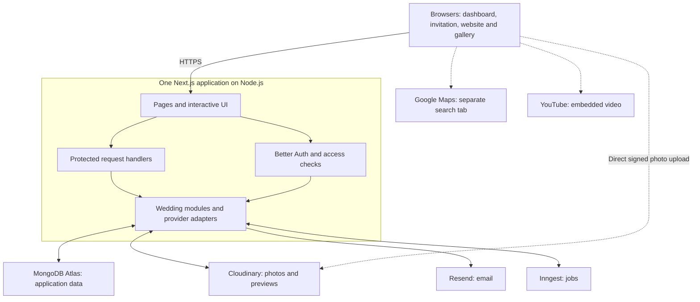
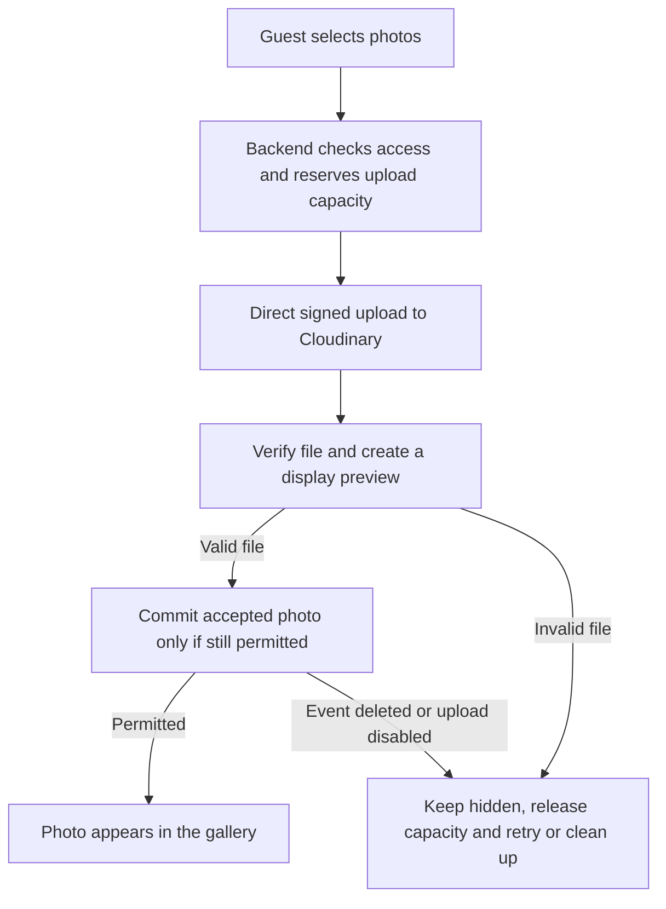

# KalyanaPura V1 — System Design Architecture

Version 1.0 \| 8 October 2026 \| Architecture baseline for implementation planning

### Architecture decision

We will build KalyanaPura as one full-stack Next.js application running on Node.js, organised into small wedding modules. MongoDB Atlas holds application data; Cloudinary holds images; Better Auth handles member accounts. Resend delivers email and Inngest coordinates background jobs. Guests participate through links and QR codes without creating accounts.

The private dashboard and guest pages share the same application and wedding information, but each request receives only the data and permissions appropriate to its access path. Simplicity is a design requirement: one codebase, one application deployment unit and no microservices.

| **Area**              | **Selected direction**                                   |
|-----------------------|----------------------------------------------------------|
| Application           | Full-stack Next.js modular monolith on Node.js           |
| Data                  | MongoDB Atlas managed cluster                            |
| Member authentication | Better Auth with database-backed sessions                |
| Images                | Cloudinary only; no additional S3 service                |
| Jobs and email        | Inngest coordination and Resend delivery                 |
| Vendor discovery      | Open Google Maps searches; My Vendors stays in the app   |
| Public website        | Selected public events and presentation content          |
| Guest gallery         | Shared link or QR; all wedding albums; no guest accounts |
| Deployment            | Provider, sizing and live configuration deferred         |

### Document boundaries

This document defines components, responsibilities, access rules, data movement, key flows, failure handling and implementation checks. Database collections, fields, indexes, detailed API contracts, final UI layouts and deployment commands belong to later documents. A custom domain may be purchased when deployment and email are configured; other hosting costs must be discussed rather than silently enabled.

## 1 Product contract

The approved PRD describes a family wedding workspace. The decisions below are the agreed clarifications and overrides that implementation must preserve. Admin and Manager are wedding roles, not global platform administration roles.

### Wedding membership

- Each account belongs to at most one active wedding. A wedding may have several Admins and Managers. Its creator becomes the first Admin.

- Admin chooses the invited role; Manager is the default. Member invitations are email-bound and expire after seven days. They can be resent.

- An existing account can accept an invitation after proving ownership of the invited email. If it already belongs to a wedding, joining is blocked with a simple message; there is no automatic transfer.

- Members can leave, and Admins can remove members or change roles. The final Admin cannot be removed, leave or be demoted. Tasks assigned to a departing member become unassigned.

- All members share wedding planning information. Only Admins administer members and delete gallery photos. Both roles can toggle guest uploads.

### Guests and public content

- A guest represents one invitation with a maximum party size. Name is required; email and phone are optional. Attendance is one overall RSVP across the invited events, not a separate response per event.

- The attendance number includes the named guest. Attending permits an integer from one to the organiser limit; Not Attending means zero. Guests and organisers can update a response.

- Invitation links remain usable after the wedding unless removed, disabled or replaced. Replacement immediately invalidates the old invitation link. There is no automatic RSVP closing date.

- The personal invitation shows only selected invited events. The public website shows only events explicitly selected for public publication. Anyone with valid gallery access can browse all wedding albums.

- Guests need not provide identity details to upload. Individual photo downloads are available. Event selection is optional; unassigned uploads appear in Wedding Memories.

### Saved changes and deletion

Saved event details appear on existing invitation links and the published website. No automatic change email is sent. Unpublishing the website does not disable invitations or the gallery, and changes to couple names do not change the chosen website address.

Deleting an event deletes its linked tasks, expenses and photos, removes it from invitations and the website, and detaches it from retained vendor records. Guests and unrelated wedding data remain. An event containing photos requires an Admin to delete it. Section 13 defines the confirmation and cleanup flow.

## 2 System context

Figure 1 Application boundary and external integrations

Next.js serves the four experiences and runs the backend in the same Node.js application. Better Auth is an internal library. Atlas, Cloudinary, Resend and Inngest are external managed services; their credentials remain on the server.

The browser connects to Cloudinary directly only for a backend-authorised upload. Gallery viewing and downloads go through access-controlled application media routes. Inngest invokes signed job handlers in the same application, so no separately hosted custom worker is required. Google Maps discovery opens a separate tab, while YouTube streams the configured embedded video.

Modules communicate through local service functions. We do not introduce inter-service HTTP calls, a message broker we must operate, or a second Express backend. Additional infrastructure requires a demonstrated need.

## 3 Frontend and backend boundaries

### Frontend responsibilities

The interface displays permitted information, handles forms and filters, provides mobile upload progress, and presents useful errors. It can check form inputs for convenience, but its checks never replace backend validation. Role-specific buttons are presentation aids, not access protection.

### Backend responsibilities

The backend validates input, resolves access, enforces wedding boundaries, applies product rules, persists changes and calls providers. It owns role decisions, attendance limits, allowed public fields, upload authorisation, deletion and email eligibility. A browser-provided wedding ID never establishes ownership.

| **Surface**           | **Entry and access**                           | **Permitted response**                                 |
|-----------------------|------------------------------------------------|--------------------------------------------------------|
| Account pages         | Signup, login and reset through Better Auth    | Account and verification status                        |
| Dashboard             | Member session plus live wedding membership    | Wedding planning data                                  |
| Invitation            | Unpredictable guest invitation token           | Guest greeting, invited events, RSVP and gallery entry |
| Website               | Stable wedding address plus published status   | Selected public presentation content                   |
| Gallery               | Valid shared access or active invitation grant | Visible photos and upload availability                 |
| Media                 | Member or guest access plus photo ownership    | Authorised preview or individual download              |
| Integration callbacks | Verified provider signature                    | Acknowledgement or job result; no user dashboard       |

### Next.js request pattern

Use Server Components for initial page rendering and Client Components for interaction. Initial server-rendered reads call the internal service layer directly. Browser mutations use Route Handlers, which call the same services; avoid introducing a second mutation framework in V1. Better Auth and provider callbacks use their required handlers. All handlers are reachable HTTP entry points and require their own access checks. \[1\]

Pages and components do not query MongoDB directly. Database access and provider secrets live in server-only code. Use the Node.js runtime for database, auth and integration handlers. TypeScript is the recommended implementation language; it adds no separate runtime service.

## 4 Internal modules

Each module owns its business rules. Keep handlers thin and use straightforward service and data-access functions. These are code boundaries within a monolith, not separate deployments.

| **Module**                    | **Responsibility**                                           | **Important boundary**                            |
|-------------------------------|--------------------------------------------------------------|---------------------------------------------------|
| Accounts and membership       | Signup, verification, sessions, member invitations and roles | Auth identity and wedding membership are distinct |
| Wedding and events            | Wedding identity, location, dates and event lifecycle        | Coordinates event deletion                        |
| Tasks                         | Assignment, progress, priorities and filters                 | Assignee and event belong to the current wedding  |
| Guests and RSVP               | Guest list, import, invited events and attendance            | One guest record is one invitation                |
| Invitations and communication | Secure links, send, resend and manual reminders              | Guest email is optional                           |
| Expenses                      | Spent or committed amounts and total                         | No budget, payments or instalments                |
| Vendors                       | Contacts, agreed cost, events and notes                      | Discovery does not import Google results          |
| Website and livestream        | Themes, published content and YouTube configuration          | Public fields are explicitly selected             |
| Gallery and media             | Albums, uploads, access, downloads and QR                    | Originals and previews remain protected           |
| Integration adapters          | Cloudinary, Resend and Inngest calls                         | Provider mechanics stay outside product logic     |

### Shared application services

Use a small shared layer for access checks, validation, configuration, request IDs, error handling and bounded background work. Do not build a generic workflow engine or permission framework. Explicit checks for Admin, Manager and guest capabilities are sufficient.

### Storage ownership

Atlas stores business information, sessions, token lookup material, photo metadata and durable operation status. Cloudinary stores the image bytes and display versions. The application filesystem is temporary workspace only. Reuse a process-level MongoDB client and bounded connection pool; do not create a new client for each request. \[4\]

## 5 Authentication and member onboarding

### Account authentication

Better Auth provides the account mechanisms; the application supplies wedding membership rules. Use email/password signup, verified email ownership, logout and password reset with database-backed sessions. Keep the session cookie HttpOnly and Secure on HTTPS, with SameSite protection and trusted-origin checks. The browser never receives a password hash or provider secret. \[2\]

Set an absolute session lifetime of seven days for V1 and disable sliding renewal if needed to preserve that lifetime. After expiry, ask the member to log in again. Disable session cookie caching for authoritative checks so logout, reset and revocation are not delayed. Password reset revokes existing sessions; role and membership are reread for protected requests. \[2\]

### Create wedding flow

1\. The user signs up and verifies their email. If they followed a member invitation, preserve that context rather than showing the create-wedding prompt.

2\. Without an invitation or existing membership, show wedding creation. Collect the required couple names, date and location.

3\. Create the wedding and first Admin membership as one protected operation. Concurrent submissions cannot create two active memberships.

4\. Open the dashboard shell. Optional title, description and cover can be added immediately or later.

### Join existing wedding flow

1\. An Admin sends an email-bound invitation with a selected role, defaulting to Manager. Its acceptance window is seven days.

2\. The recipient signs up or logs in using the invited email, then verifies email ownership. A forwarded link cannot join a different email account.

3\. The backend checks the invitation, its expiry, the inviter authority where applicable and whether the account already belongs to a wedding.

4\. Acceptance creates membership and consumes the invitation once. Repeated acceptance returns the joined state rather than creating a duplicate.

5\. A user already in another wedding receives a simple message. There is no transfer or multi-wedding account flow.

### Leaving and removal

Leaving, removal and demotion enforce the last-Admin invariant even under concurrent requests. Removal or departure unassigns that member’s tasks and denies new dashboard requests. An old login session cannot restore wedding access. Retrying the operation does not repeat side effects.

## 6 Permissions and wedding isolation

| **Action**                               | **Admin** | **Manager** | **Guest**         |
|------------------------------------------|-----------|-------------|-------------------|
| Manage wedding, events and tasks         | Yes       | Yes         | No                |
| Manage guests, invitations and RSVP      | Yes       | Yes         | Own RSVP only     |
| Manage expenses and vendors              | Yes       | Yes         | No                |
| Publish website and configure livestream | Yes       | Yes         | No                |
| Invite, remove or change members         | Yes       | No          | No                |
| View and upload gallery photos           | Yes       | Yes         | With valid access |
| Download an individual photo             | Yes       | Yes         | With valid access |
| Delete an individual photo               | Yes       | No          | No                |
| Delete an event with photos              | Yes       | No          | No                |
| Delete an event without photos           | Yes       | Yes         | No                |
| Toggle guest gallery uploads             | Yes       | Yes         | No                |

### Enforcement order

1\. Resolve account identity or validate the guest access grant. Guest links never create Wedding Member permissions.

2\. For members, resolve current membership and wedding from trusted server state. For guests, derive the wedding from the validated link.

3\. Resolve the requested resource within that wedding. Reject an event, vendor, photo or guest that belongs elsewhere.

4\. Check role or guest capability, current settings and operation eligibility, then validate input and perform the action.

### Protect every path

Apply the same rules to reads, mutations, media delivery, dashboard summaries, import operations and job callbacks. A nested resource ID or a background job does not bypass wedding isolation. Return a generic unavailable response for inaccessible guest links or resources rather than revealing another wedding’s details.

Normal authenticated work requires a current Admin or Manager membership. Background user-requested jobs recheck continuing authority before sending invitations or publishing uploaded media. System cleanup uses narrow internal authority; it cannot expose wedding content to the caller.

The event deletion restriction preserves Admin-only photo deletion. Managers are not given an indirect way to delete photos through another feature. The UI shows why an Admin must handle an event that contains photos.

## 7 Invitations and RSVP

### Invitation capabilities

Generate a cryptographically random invitation token with at least 128 bits of entropy; use 32 random bytes as the implementation default. Associate it with one wedding guest. Keep a hash for lookup and protect any retained token material needed for copying and resending. Never place these secrets in analytics or ordinary logs.

The same active link shows current wedding branding and the guest’s current invited events. Replacing the link invalidates the old token and any derived access grants. Removing the guest also invalidates the link. Guest links have no automatic wedding-date expiry; invalid, disabled or replaced links show a friendly unavailable page.

### RSVP flow

1\. Guest opens the invitation. The server validates its token and returns a narrow invitation view, without guest-list, member or finance data.

2\. Guest selects Attending or Not Attending. Attending requires a whole-number party size within the current maximum, including the named guest.

3\. Server validates the current guest limit and event availability, then updates the same RSVP rather than creating another response.

4\. Show the saved result. A later visit or organiser edit can update it; duplicate submissions do not increase attendance totals.

5\. Organisers can record a response received by phone. There is no per-event RSVP or automatic closing date in V1.

### Count definitions

Guest count means invitation records. RSVP response count includes Attending and Not Attending; Pending is unanswered. Expected attendance sums only accepted party sizes. A guest allowed four people who selects three means three total attendees, not the named person plus three.

If the maximum is lowered below an existing attendance number, block that edit with a clear message until the organiser also corrects the attendance. Never silently alter an RSVP or allow invalid totals.

### Email and WhatsApp

Email sending requires a valid guest email; guests without one still receive a copyable link. The WhatsApp button opens a pre-filled message for manual sending. It neither invokes the WhatsApp API nor records the message as automatically delivered. Deleting or editing an event updates the linked invitation; it does not rewrite previous emails or send automatic change alerts.

## 8 Email and background work

### Email types

Resend handles account verification, password reset, member invitations, guest invitations, resends and manually requested Pending reminders. Configure a verified sending domain at deployment. A domain purchase is allowed, but no purchase or live sender configuration is part of this design stage. Provider acceptance is different from inbox delivery. \[7\]

### Durable request flow

1\. Authenticate the organiser and resolve the target wedding and guests. Validate email eligibility and current Pending status for reminders.

2\. Persist the requested operation and its delivery work before reporting that it is queued. A lost provider call must not erase the user’s requested action.

3\. Publish the work to Inngest. Its HTTP integration calls signed handlers in this Next.js application; business logic remains in the monolith. \[6\]

4\. Each job reloads current eligibility and uses a stable operation key. Automatic retries reuse that key; an intentional resend creates a new operation.

5\. Submit a bounded batch or individual message to Resend. Store its provider reference and accepted or failed result.

6\. Verify provider webhook signatures and update delivered, bounced or failed status when available. Duplicate or late callbacks cannot reverse a newer state.

### Retries and duplicate protection

Assume a job can execute more than once. Persist completion checks and use provider idempotency for retries, within the provider’s documented validity window. Do not promise exactly-once email delivery after an ambiguous network failure. After bounded retries, retain a failed operation for an organiser to retry. \[7\]

If MongoDB commits but job publication fails, retain an undispatched operation and republish it through a retry or reconciliation task. This is a small durable delivery record, not a new user-facing workflow. Its exact persistence design belongs to database design.

### Keep the system responsive

Give password-reset and verification work priority over bulk invitations. Bound email and image concurrency independently. Respect provider-wide quotas across all weddings, rather than treating each wedding as having its own free allowance. If limits are reached, show queued or temporarily unavailable status rather than enabling a paid upgrade.

Background coordination is external, but execution still uses the application host. Cold starts, host limits and callback timeouts must be tested together at deployment. No work relies solely on an in-memory timer continuing after a request ends.

## 9 Website livestream and vendor discovery

### Publication and themes

The website uses one shared presentation model with three predefined themes. Content and access decisions are independent of theme choice. Before first publication, only Wedding Members can preview it. Publishing exposes the explicitly selected public wedding information; after publication, saved changes become live.

Use a stable, unique website address chosen once. Renaming the couple or wedding does not change it. Unpublishing denies public website access and invalidates cached pages while leaving personal invitations and gallery access unaffected.

### Public information boundary

Expose couple names, wedding date, welcome text, selected public events, selected covers, venue/map information and configured livestream. Never include the guest list, RSVP identity, phone numbers, notes, tasks, expenses or internal vendor contacts in the public response.

Wedding and event covers deliberately used on a published page are public presentation assets. Guest gallery originals and previews remain protected. Do not place the shared gallery token on the public website: doing so would give every website visitor gallery access. A token-accessible invitation can provide a gallery entry when settings allow it.

### Livestream and venue links

Accept recognised YouTube URLs, extract and validate the video identifier, and construct a fixed YouTube embed. Reject arbitrary iframe HTML and other hosts. The browser loads video from YouTube; KalyanaPura does not relay, record or host the stream. Venue buttons open Google Maps directions or search links.

### Vendor discovery and My Vendors

The organiser selects a category and city. Build an encoded Google Maps search URL and open it in a new tab. Google Maps shows the results; no Google Places API key, API billing or local results cache is needed. Maps URLs support search without an API key. \[8\]

The organiser returns and manually adds the chosen business to My Vendors. Store the information they enter, including contacts, agreed cost, related events and notes. Discovery does not scrape, automatically import ratings, calculate distance or synchronise Google business details. These are explicit changes from the original PRD’s in-app discovery concept.

My Vendors remains fully available if Google Maps is unavailable. V1 contains no booking or payment transaction with the discovered business. Google Places integration can be reconsidered later without changing the core vendor management module.

## 10 Gallery access and QR codes

### Shared wedding gallery

Each wedding has a shared gallery capability represented by an unpredictable link. Possession of that link grants the enabled guest viewing, uploading and individual-download actions. It does not prove someone’s identity or grant access to the planning dashboard. Guests may forward it; V1 intentionally avoids per-person gallery permissions.

A valid personal invitation can enter the same gallery under a scoped guest grant. The invitation remains restricted to its invited events, while the gallery includes all wedding albums as agreed. There are no invitation-specific album restrictions.

### Stable QR flow

1\. Generate the QR within the application, encoding the canonical HTTPS gallery entry URL. No paid QR service or image-provider URL is involved.

2\. A scan opens the mobile gallery entry. Validate the capability and current gallery settings before granting access.

3\. Optionally exchange the link for a protected guest-access cookie and continue on a clean URL. This is an anonymous access grant, not a guest account.

4\. Offer viewing and uploading according to settings. Generate fresh upload authorisations only when uploads are enabled.

5\. The same QR continues to work after the wedding date and after viewing or uploads are disabled and re-enabled.

### Settings and permissions

Both organiser roles can independently enable guest gallery viewing and guest uploads. Gallery-disabled settings affect guests; organisers retain dashboard access. Upload-only sharing is possible without exposing the gallery list. Only Admins delete photos. Photos can be assigned to an event or to Wedding Memories.

Disabling access blocks new page, media and upload requests, including upload finalisation. Information already downloaded to a guest’s device cannot be recalled. Use noindex directives, private cache policies and referrer protection on guest pages; search-engine exclusion supplements token checks and never substitutes for them.

### Link leakage

The printed QR has a stable URL. V1 can disable its guest capabilities without changing that URL. Replacing a compromised gallery token would break existing printed QR codes, so routine gallery-token rotation is not introduced as a separate V1 workflow. Invitation-token replacement remains available and independent.

## 11 Secure photo upload flow

Figure 2 A photo becomes visible only after successful verification

### Authorise and reserve

Check the member or guest grant, guest-upload setting, event ownership and wedding storage capacity. Reserve capacity before issuing signed upload parameters for a backend-selected asset identifier and authenticated delivery type. The guest cannot choose another wedding’s folder or replace an existing asset.

### Upload and verify

Upload directly to Cloudinary with progress per file. Treat signatures as temporary capabilities, not guaranteed single-use tickets. Use non-overwriting identifiers, provider restrictions and a recorded reservation to prevent replay from becoming unlimited accepted uploads. Verify the asset through trusted provider metadata or a signed callback; never trust browser-reported success alone.

### Publish or clean up

Validate the detected image format, byte size and decoded dimensions. Prepare a safe display preview and recheck current access, event state and quota before marking the photo visible. A deleted event, disabled upload setting or expired reservation prevents acceptance. Hide and remove failed or orphaned provider assets through retryable cleanup jobs.

The guest sees Uploaded or Preparing while this runs. There is no human moderation approval. Gallery visitors see accepted photos on the next fetch or refresh; no WebSocket connection or automatic collaborative live feed is required.

## 12 Image storage and delivery

### Accepted uploads

| **Setting**          | **V1 baseline**                                                       |
|----------------------|-----------------------------------------------------------------------|
| Maximum photo size   | 10 MB per file, enforced by server and provider                       |
| Batch selection      | Up to 20 files; small bounded upload concurrency                      |
| Initial formats      | JPEG, PNG and WebP                                                    |
| iPhone compatibility | Enable and test HEIC/HEIF conversion before real guest use            |
| Other formats        | Reject SVG, PDF, GIF animation, RAW camera files and video            |
| Storage capacity     | Configurable per-wedding and account-wide caps; exact values deferred |
| Visibility           | After validation and a usable display preview are ready               |
| Downloads            | Uploaded quality; individual files, no bulk album export              |

Cloudinary supports HEIC/HEIF conversion. Test mobile selection, orientation and protected delivery together. Enforce image-dimension and processing limits before decoding. \[5\]

### Originals and previews

Preserve uploaded quality for individual downloads. Generate a fixed set of display sizes, including small gallery previews. Correct orientation and remove location metadata from display versions. Keep private originals out of public markup and shared image-optimisation caches.

### Private delivery baseline

Use authenticated Cloudinary assets for originals and previews; the private delivery type alone leaves some derived images public. Pre-generate permitted display versions for authenticated delivery. \[5\]

An application media route verifies current access and photo ownership, fetches the provider image server-side, and streams it with private no-store headers. Do not redirect to a reusable provider URL. The public website uses separate public cover assets.

Streaming consumes both application and provider bandwidth; check free allowances before deployment. Ordinary signed CDN URLs do not imply expiry. Cloudinary’s temporary private-download API carries a bandwidth tradeoff and is not the default gallery embed. \[5\]

### Retention

The wedding date does not delete photos or close the gallery. Capacity limits pause new uploads while retaining existing photos. Before live use, agree retention and export/recovery arrangements; permanent free storage is not promised. Explicit photo and event deletion still remove selected media.

## 13 Planning data and event deletion

### Tasks expenses and vendors

A task has at most one assignee and may be unassigned or unrelated to an event. Any current member can update any task. The assignee indicates responsibility, not exclusive editing authority. Multiple tasks may be assigned to the same member.

Expenses record money spent or committed in INR. Event and vendor associations are optional. Validate amounts and calculate totals using exact monetary units, not binary floating-point arithmetic. Agreed vendor cost is descriptive information and is not automatically added to expenses, preventing double-counting.

Vendors may serve several events or no event. Vendor records and expenses remain valid independently. Removing a vendor detaches its association from retained expenses rather than deleting the expense; actual money records should not disappear through vendor cleanup. No payment schedule or budget calculation is added.

### Event deletion contract

| **Affected information**      | **Required result**                               |
|-------------------------------|---------------------------------------------------|
| Tasks linked to this event    | Delete                                            |
| Expenses linked to this event | Delete and exclude from expense totals            |
| Photos assigned to this event | Hide immediately and delete provider assets       |
| Guest invitations             | Remove this event; keep guest and invitation link |
| Website                       | Remove event from published and preview content   |
| Vendors                       | Detach this event; retain vendor and other events |
| Unrelated wedding data        | Keep                                              |

### One clear confirmation

Show affected task, expense and photo counts plus the recorded expense amount being removed. Explain that deletion removes the records even if money was already paid. This is a destructive action; no automatic cancellation email or refund workflow is introduced.

Check current related photos at commit time. If any exist, require Admin authority. Put the event into an inaccessible deletion state, reject new event-related writes, then complete database cleanup. External photo deletion follows a durable retryable job. Show completion only when the application state is consistent; provider cleanup can remain pending internally.

If an upload finishes after deletion started, it cannot recreate the event or publish a linked photo. Cleanup retries only the assets identified for this operation, never a whole wedding folder.

## 14 Consistency and caching

### One source of truth

Atlas is the authoritative source for product state. Dashboard summaries, invitations and websites read views of that state; they do not maintain independently editable wedding copies. Cloudinary asset existence does not by itself mean a photo is accepted into the gallery.

Use wedding-scoped reads and mutations. A stored relation to an event, guest, member or vendor must be validated within the same wedding. The exact query, index and transaction design follows in database design.

### Concurrent changes

- Enforce one active membership and at least one Admin using an atomic or serialised operation. A count check followed by an unprotected write is insufficient.

- Make RSVP submissions, invitation acceptance and upload finalisation repeatable without increasing counts or creating duplicate records.

- Reserve upload capacity atomically so simultaneous guests cannot all pass the same remaining-space check. Release expired or failed reservations.

- When an organiser edits stale information, detect the changed record and ask them to reload. Do not silently overwrite a newer edit where it changes roles, guest limits or destructive actions.

- Recheck event deletion, role changes and upload settings at the final write. Starting an action earlier does not guarantee it is still permitted.

### Caching baseline

Start with dynamic reads for the small V1 pilot. Private dashboard, invitation, gallery and media responses must not enter shared public caches. Public website content can be cached later only with wedding-scoped keys and reliable invalidation after edits, deletion or unpublishing. Static application assets and deliberate public covers can use normal public caching.

After a successful local action, refresh the affected page data and summaries. Other organisers see changes on their next fetch or refresh. Real-time collaboration is outside V1; MongoDB change streams, WebSockets and a Redis cache are not required.

### Time and amounts

Use Asia/Kolkata as the V1 wedding timezone and INR for currency. Display event times in that timezone regardless of the guest’s device location. Treat the wedding date as a local calendar date so UTC conversion does not shift the countdown or date label. Reception events may occur after the primary wedding date.

## 15 Errors and recovery

Failures should affect the smallest possible part of the product. Keep forms and progress visible, explain the next action and never report an unsaved operation as complete.

| **Situation**                      | **User experience**                                 | **Recovery**                                              |
|------------------------------------|-----------------------------------------------------|-----------------------------------------------------------|
| Atlas unavailable                  | Temporarily unavailable; no false save confirmation | Retry bounded reads; preserve entered form values         |
| Invalid invitation or gallery link | Link unavailable with organiser contact guidance    | No wedding details exposed                                |
| Member removed during a session    | Dashboard access ends on the next protected request | Current membership check; pending work rechecks authority |
| Email provider unavailable         | Queued or failed, not delivered                     | Persist operation and retry with duplicate protection     |
| Job coordinator unavailable        | Background work remains pending                     | Keep dispatch intent and reconcile when available         |
| Photo upload interrupted           | Individual photo failure and retry option           | Do not restart already accepted photos                    |
| Unsupported or oversized photo     | Explain allowed types and size                      | Reject before upload where possible; verify afterward     |
| Cloudinary unavailable             | Upload or photo temporarily unavailable             | Keep planning features available; retry media cleanup     |
| Event deleted during upload        | Photo cannot be added to this event                 | Hide uploaded asset and clean it up                       |
| Storage or send allowance reached  | Clear temporary limit message                       | Pause affected work; no automatic paid upgrade            |
| Repeated callback or submit        | Show existing operation result                      | Idempotent transition; prevent duplicate side effects     |
| Google Maps or YouTube unavailable | External service unavailable                        | My Vendors and the rest of the workspace remain usable    |

### Import handling

Guest import uses one simple CSV format, with a preview and row-level validation errors before saving. Exact columns, duplicate handling and maximum import size are deferred to API and UI design. Import never sends invitations automatically. Email-free rows remain valid if a name and valid party limit are provided.

### Operational recovery

Keep durable pending work for failed email delivery, upload verification and external deletion. Reconciliation identifies operations stuck past their expected duration. Report permanent failures to the operator through technical monitoring; an in-app notification centre and product activity log are not introduced.

## 16 Security and observability

### Required security controls

- Validate access at the service/data boundary for every private and guest action. Use trusted-origin checks and CSRF protection for cookie-based mutations.

- Keep secrets in server configuration. Redact passwords, reset tokens, invitation tokens, gallery tokens, signatures and email bodies from logs. Limit database and provider credentials to the required capabilities.

- Verify signatures on Inngest, email and image-provider callbacks. Accept duplicate callbacks safely; reject unverifiable requests before changing product state.

- Use request, per-link and per-wedding limits for login, RSVP, upload signing and email sending. Store durable counters where needed; an in-memory limit alone is insufficient across restarts.

- Validate URLs and render user content as text. Allow only recognised YouTube hosts and constructed Maps URLs. Fetch media only from backend-selected provider locations, never an arbitrary browser URL.

- Serve guest pages with noindex, private cache policies and no-referrer protection. Do not include bearer tokens in public sitemaps or link-tracking systems.

- Publish only accepted images; restrict formats, dimensions, byte size and transformations. No unsigned unrestricted upload preset or guest-controlled asset identifier is allowed.

### Useful technical monitoring

Record request IDs, route family, duration, safe error category, provider references and job status. Monitor error rate, rejected access, upload failures, job age, email failures, storage consumption, provider quotas and database connection pressure. These technical records are for operating the application, not a user-facing activity log.

### Product measures

Track a small set of counts: wedding activation, events/tasks/guests added, completed tasks, RSVP responses, accepted uploads and QR visits. Avoid guest identity and token values in analytics. Invitation open measurements are approximate because automated scanners can open email links; RSVP responses are the stronger engagement signal.

### Recovery and service limits

Select backup and restore procedures before real wedding data is accepted. Atlas Free does not include managed backups; a manual export and tested restore is the pilot fallback. Provider replication and account access are not a backup strategy. \[4\]

Free plans provide finite capacity and do not establish a production uptime guarantee. Keep quotas explicit and show honest pending or unavailable states when an external dependency cannot complete work.

## 17 Performance and validation

### Workload assumptions

Design for families collaborating intermittently, hundreds of invitation records and bursts of mobile photo uploads around wedding events. These are product-context assumptions, not a measured capacity guarantee. The supported number of simultaneous weddings and guests must be established with deployment testing.

### Simple performance measures

- Paginate guests, expenses, vendors and photos; avoid returning an entire wedding’s images in one response.

- Use small previews, lazy loading and bounded upload concurrency. Direct signed uploads keep original photo bytes off the application upload path.

- Calculate dashboard summaries with bounded database work. Add indexes during database design based on actual filters and access paths.

- Reuse database connections, limit provider calls and keep image work out of normal page requests.

- Start with dynamic public pages. Introduce caching or another service only after a measured bottleneck justifies it.

### Acceptance checks for implementation

| **Area**      | **Required evidence**                                                                  |
|---------------|----------------------------------------------------------------------------------------|
| Isolation     | Changing IDs cannot read or modify another wedding through any entry point             |
| Accounts      | Email-bound invitation, expiry, reset, removal and last-Admin concurrency work         |
| RSVP          | Duplicate submit, organiser edit and party-limit validation preserve correct totals    |
| Website       | Only selected events are public; unpublishing leaves guest links working               |
| Photos        | Mobile upload, HEIC conversion, invalid bytes, retries and capacity limits work        |
| Privacy       | Unauthorised originals and previews are denied; public caches reveal no gallery data   |
| Deletion      | Related data disappears; guests/vendors remain; races cannot restore photos            |
| Jobs          | Provider outage, duplicate callback and restart recover without repeated accepted work |
| Cost controls | Quota exhaustion pauses work; no upgrade or billing fallback is enabled                |

### Responsiveness target

Set provisional implementation targets of a two-second p95 for simple reads and three-second p95 for small writes on a warm host, excluding uploads and external job completion. Measure before adopting these as launch targets. A free host cold start is measured separately and cannot be hidden inside a warm-response promise.

## 18 Implementation sequence and deferred decisions

Build complete small workflows in the PRD’s order. Security checks and failure handling accompany each phase rather than being postponed until the end.

| **Phase**              | **Working result**                                                                  |
|------------------------|-------------------------------------------------------------------------------------|
| 1 Foundation           | Accounts, verification, wedding creation, member joining, roles and dashboard shell |
| 2 Planning             | Events, tasks, assignment, filters and consistent summaries                         |
| 3 Guests               | Guest list/import, secure invitations, RSVP, email jobs and WhatsApp sharing        |
| 4 Vendors and expenses | My Vendors, external Maps discovery and expense tracking                            |
| 5 Wedding website      | Three themes, selected public events, stable address and YouTube embed              |
| 6 Memories             | Protected gallery, mobile uploads, previews, downloads, albums and stable QR        |
| 7 Release checks       | Isolation, deletion races, retries, recovery, responsiveness and service limits     |

### Deployment decisions to make later

- Select a Node.js-compatible host and region, including whether its free service sleeps. Render remains a candidate, not a committed deployment choice.

- Set the canonical domain before printing real QR codes. Purchasing a domain is permitted; configure DNS, HTTPS and the verified email sender together.

- Confirm current free allowances for compute, Atlas, Cloudinary, Resend and Inngest. Choose application-level caps and keep paid upgrades or overages disabled.

- Test private media transfer and background callbacks on the actual host. Confirm timeout, bandwidth, connection and cold-start limits together.

- Agree photo retention, recovery procedures, operator access and a realistic initial wedding/guest capacity.

### Next design stage

Database design will specify collections, relationships, atomic constraints, indexes, retention mechanics and integration operation records. API design will specify request/response contracts, validation, error codes and pagination. UI design will turn the approved behaviours into screens. None of those details are frozen by illustrative routes or flows in this document.

### Changes from the original PRD

The architecture incorporates the agreed Admin-only photo deletion rule, selected public events, guest downloads, email-bound member invitations, event cascade deletion and Google Maps discovery outside the app. The shared gallery remains separate from the public website. V1 continues to exclude guest accounts, budgets, bookings/payments, WhatsApp API, real-time collaboration, complex permissions and AI features.

## 19 Technical references and terms

The PRD and the agreed product decisions define product behaviour. The primary references below substantiate integration capabilities and constraints. Service plans and limits must be checked again when deployment is selected. References were checked on 8 October 2026.

[\[1\] Next.js backend entry points and server-side boundaries](https://nextjs.org/docs/app/guides/backend-for-frontend)

[\[2\] Better Auth session management](https://better-auth.com/docs/concepts/session-management)

[\[3\] Better Auth MongoDB adapter](https://better-auth.com/docs/adapters/mongo)

[\[4\] MongoDB connection pools](https://www.mongodb.com/docs/drivers/node/current/connect/connection-options/connection-pools/)

[\[4\] MongoDB Atlas Free limits and backup constraints](https://www.mongodb.com/docs/atlas/reference/free-shared-limitations/)

[\[5\] Cloudinary media access and authentication](https://cloudinary.com/documentation/control_access_to_media)

[\[5\] Cloudinary image format support](https://cloudinary.com/documentation/image_format_support)

[\[5\] Cloudinary plans and usage accounting](https://cloudinary.com/documentation/billing_and_plans)

[\[6\] Inngest functions served through HTTP](https://www.inngest.com/docs/learn/serving-inngest-functions)

[\[6\] Inngest durable execution limits](https://www.inngest.com/docs/durable-execution/limits)

[\[7\] Resend idempotency keys](https://resend.com/docs/dashboard/emails/idempotency-keys)

[\[7\] Resend sender domain requirements](https://resend.com/docs/knowledge-base/403-error-resend-dev-domain)

[\[8\] Google Maps URLs](https://developers.google.com/maps/documentation/urls/get-started)

[\[9\] Render free hosting limitations for later deployment evaluation](https://render.com/docs/free)

### Plain language terms

| **Term**             | **Meaning in this document**                                    |
|----------------------|-----------------------------------------------------------------|
| Monolith             | One application, organised into modules                         |
| Session              | A protected temporary pass for a logged-in member               |
| Capability link      | A link that grants a narrow set of guest actions                |
| Job                  | Saved work that can finish outside the initiating page request  |
| Idempotent operation | Repeating the same request does not repeat its completed effect |
| Webhook              | A signed provider request reporting an event or invoking work   |
| Reconciliation       | Finding unfinished work and safely continuing or cleaning it up |
